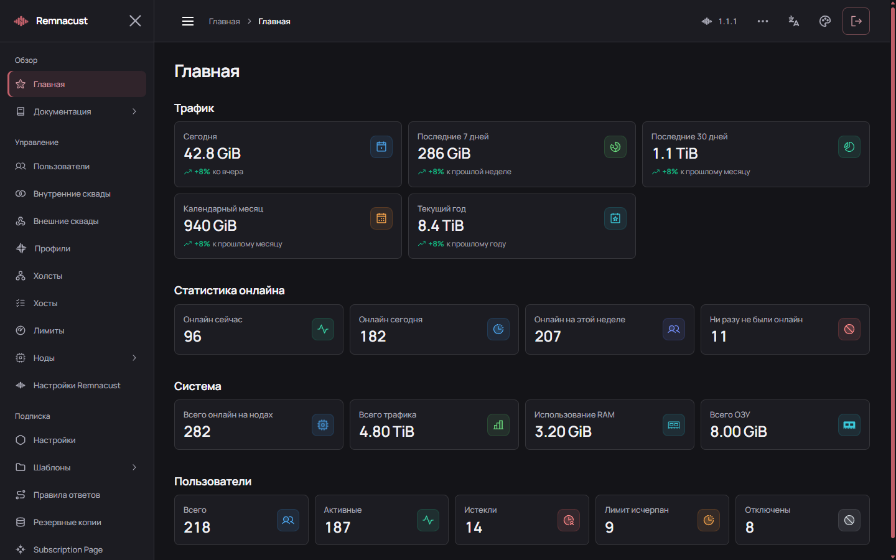

# Remnacust Panel

Панель управления пользователями, устройствами, подписками и нодами Xray на основе Remnawave. В репозитории находятся backend, frontend и отдельный сайт подписки.

## Где редактировать .env и Docker

При установке через скрипт каждый компонент имеет один постоянный рабочий каталог:

| Компонент | Окружение | Docker Compose |
| --- | --- | --- |
| Панель | `/opt/remnacust/panel/.env` | `/opt/remnacust/panel/docker-compose.yml` |
| Нода | `/opt/remnacust/node/.env` | `/opt/remnacust/node/docker-compose.yml` |
| Страница подписки | `/opt/remnacust/subscription-page/.env` | `/opt/remnacust/subscription-page/docker-compose.yml` |

Для существующей установки сначала выполните `cat /opt/remnacust/FILES.txt`. Явно выбранный внешний каталог может отличаться. Скрытые файлы видны через `ls -la`.

```bash
cd /opt/remnacust/panel
nano .env
docker compose config --quiet
docker compose up -d --no-build --pull never
```

`restart` не перечитывает `.env`: после изменения окружения контейнеры нужно пересоздать. Сохраняйте исходный `APP_SECRET`, ключ ноды и реквизиты БД. Копии находятся в `backups/`, журналы — в `logs/`; новые рабочие папки с датами при каждом обновлении не создаются. Перенос старой структуры: `sudo remnacust normalize-layout --component panel` или `--component node`.

## Текущий стабильный комплект

Актуально на 1 ноября 2026 года. Версии компонентов имеют отдельную нумерацию.

| Компонент | Версия | Основа |
| --- | --- | --- |
| Панель и страница подписки | [1.1.7.85](https://github.com/lottman/Remnacust-panel/releases/tag/v1.1.7.85) | Remnawave backend/frontend 3.4.7, Subscription Page 8.0.1 |
| Установщик и Docker-комплект | [1.2.121](https://github.com/lottman/Remnacust-installer/releases/tag/v1.2.121) | Готовые образы Linux amd64/arm64 |
| Агент ноды | [1.1.20](https://github.com/lottman/Remnacust-node/releases/tag/v1.1.20) | Remnawave Node 3.4.3 |
| Core и валидатор конфигурации | [1.1.12](https://github.com/lottman/Remnacust-core/releases/tag/v1.1.12) | Опубликованный стабильный Xray v26.10.31 |

Обновление панели не заменяет ядро удалённых нод. Для новых возможностей ядра обновляйте ноду или её Core через штатное управление. Подробности: [совместимость](docs/COMPATIBILITY.md), [последние изменения](docs/releases/1.1.7.85.md).



На снимке — демонстрационные данные.

## Установка

Установщик поддерживает Ubuntu 22.04 LTS, 24.04 LTS и 26.04 LTS, Linux amd64/arm64. Для панели: от 2 CPU, 2 GiB RAM и 20 GiB диска; рекомендуются 4 CPU и 4 GiB RAM. На VPS скачиваются готовые образы, Node.js и Go для сборки не нужны.

```bash
curl -fsSL --proto '=https' --proto-redir '=https' https://github.com/lottman/Remnacust-installer/releases/latest/download/installer.sh -o installer.sh
sudo bash installer.sh install-panel
```

Скрипт спросит версию, домен, способ HTTPS и установку сайта подписки. Для закреплённого комплекта используйте `--version 1.2.121`. Домен подтверждается отдельно; обязательные пустые ответы запрашиваются повторно. Для своего reverse proxy есть `--proxy existing`. После запуска создайте администратора в панели.

Отдельный сайт устанавливается командой `sudo remnacust install-subscription-page`; к нему можно подключить локальную либо удалённую панель с ограниченным API-токеном. [Руководство установщика](https://github.com/lottman/Remnacust-installer#readme), [документация сайта](subscription-page/README.md).

## Возможности

- Пользователи, сквады, сроки, трафик, импорт/экспорт и массовые операции. `FROZEN` приостанавливает доступ и сохраняет остаток срока; активация возобновляет отсчёт.
- HWID, персональные ключи устройств, ограничения и отзыв доступа по идентичности устройства, а не по общему IP.
- Квоты в GiB и скорость в Mbps для хостов и тегов. Отдельные пределы пользователя и устройства; активные ключи делят пользовательский бюджет, количество соединений не умножает долю.
- Профили Xray, хосты, правила ответа, дублирование шаблонов, общий черновик GUI/JSON и история изменений.
- Здоровье нод, свежесть измерений, статистика, журналы, наблюдаемые сессии и расписание записи.
- API-токены с отдельными правами операций и необязательным сроком окончания.
- Зашифрованные резервные копии PostgreSQL, расписание и отправка в Telegram.
- Темы, мобильная компоновка и руководство на RU/EN/FA/ZH.

## Автовыбор и геофайлы

Состав пула задаётся хостами **либо** тегами. Назначение привязано к конкретному автовыбору. Серверы пула и хосты, на которых показывается этот автовыбор, выполняют разные задачи. Состав доступных серверов формируется при обновлении подписки; при новом соединении сервер выбирает клиентская стратегия. Набор стратегий зависит от формата приложения. Приоритетный режим переключается на следующий доступный сервер.

Геофайлы загружаются с ПК или по HTTPS и доступны в общей библиотеке шаблонов. Можно объединять несколько наборов и выбирать категории с действиями DIRECT, REJECT или настроенной группой. Для Xray небольшие наборы встраиваются в JSON; при превышении бюджета поддерживаемые Happ/INCY получают объединённые DAT и профиль загрузки. Бюджет проверяется по каждому профилю, а не по сумме хостов. Обычная URI/Base64-подписка не переносит полную маршрутизацию и произвольные DAT.

Для этих возможностей нужна JSON-подписка: включите выдачу JSON на базовом пути или используйте `/json`. Неизменившийся профиль Happ/INCY сохраняет `LastUpdated`; смена файла, режима или настроек обновляет его ревизию. Серверное обновление источника и клиентский интервал проверки задаются отдельно. Правила GeoIP используют `IPOnDemand`, чтобы общее правило TCP/UDP не перехватывало доменное назначение раньше IP-правила.

[Автовыбор](docs/XRAY-AUTOSELECT.md) · [Геофайлы и ограничения клиентов](docs/GEOFILES.md) · [Лимиты и скорость](docs/HOST-LIMITS.md).

## Домены подписок и API

Настройка: **Подписка → Настройки → Страницы подписки**. Основной домен синхронизируется с `SUB_PUBLIC_DOMAIN` в `.env` через локальную службу установщика. У основного домена может быть до трёх CDN. В карточке пользователя доступны обычная и CDN-ссылки с отдельным копированием и QR-кодом.

Для CDN скопируйте из интерфейса источник, Host/SNI и сгенерированную пару заголовка запроса. Это сохраняет публичный CDN-адрес ссылок и геофайлов даже при замене Host на стороне CDN. Настройку ресурса VK/Yandex выполняют в кабинете провайдера; ответы подписки нельзя принудительно кешировать. Адрес подключения сайта к backend и API-токен являются серверными настройками.

Ссылки пользователя доступны через `GET /api/users/{userId}/subscription-links`, а также варианты `/primary` и `/cdn`. Для них предусмотрены отдельные права `users:subscription-links`, `users:subscription-links-primary` и `users:subscription-links-cdn`. Каталог доменов имеет собственные права. [API и примеры](docs/API.md).

## Обновление и сохранность данных

```bash
sudo remnacust upgrade-panel
sudo remnacust upgrade-node
sudo remnacust upgrade-subscription-page --page-id ID
```

Команды относятся к отдельным компонентам. Перед обновлением установщик сохраняет конфигурацию и согласованную копию БД. Обновление из панели показывает этапы и журнал. Диагностика автономности нод предупреждает о возможном перерыве, но сама по себе не блокирует обслуживание. Совместимое runtime-применение Xray сохраняет соединения; смена listener и обновление процесса могут потребовать перерыва.

## Транспорт Xera HTTP

Xera HTTP — расширение XHTTP с `network: "xera-http"` и `xeraHttpSettings`. Для соединения нужны совместимые ядра обеих сторон; обычный XHTTP остаётся отдельным транспортом. Настройки сохраняются в Xray JSON, поддержка других форматов не предполагается автоматически. [Описание](panel/frontend/public/documentation/guide-ru.md#транспорт-xera-http).

## Сборка из исходников

Для эксплуатации используйте проверенный комплект. Для разработки нужны Node.js 24, Docker/Compose v2 и отдельная тестовая БД. Установка из исходников, метаданные локального образа и команды проверок: [README панели](panel/README.md), [backend](panel/backend/README.md), [frontend](panel/frontend/README.md).

## Документация

- Руководство: [RU](panel/frontend/public/documentation/guide-ru.md), [EN](panel/frontend/public/documentation/guide-en.md), [FA](panel/frontend/public/documentation/guide-fa.md), [ZH](panel/frontend/public/documentation/guide-zh.md).
- [API и права](docs/API.md), [совместимость компонентов](docs/COMPATIBILITY.md), [совместимость нод](docs/NODE-COMPATIBILITY.md).
- [Копии БД](docs/BACKUPS.md), [восстановление старых баз](docs/DATABASE-COMPATIBILITY.md), [перенос пользователей](docs/USER-MIGRATION.md).
- [Обновление и здоровье нод](docs/UPDATE-PROGRESS-AND-NODE-HEALTH.md), [наблюдаемые сессии](docs/SESSIONS-RECORDING.md), [операции](docs/OPERATIONS.md).
- [Разработка](docs/BUILDING.md), [upstream](docs/REMNAWAVE-UPDATES.md), [история выпусков](docs/releases).

## Лицензия

Backend, frontend и сайт подписки сохраняют AGPL-3.0 и авторство Remnawave. [NOTICE.md](NOTICE.md) · [Remnawave](https://github.com/remnawave) · [Поддержка](https://t.me/lottman).
