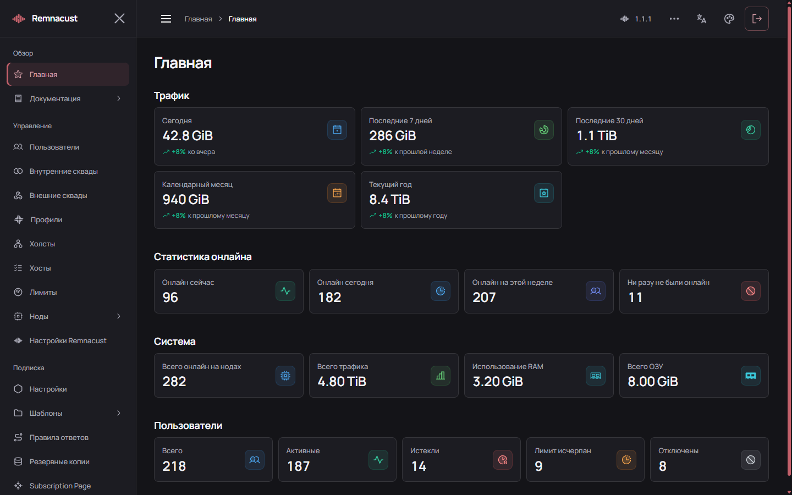

# Remnacust Panel

## Где редактировать .env и Docker

Один рабочий каталог на компонент, без дат и номеров:

| Компонент | Окружение | Docker Compose |
| --- | --- | --- |
| Панель | `/opt/remnacust/panel/.env` | `/opt/remnacust/panel/docker-compose.yml` |
| Нода | `/opt/remnacust/node/.env` | `/opt/remnacust/node/docker-compose.yml` |
| Отдельная страница подписки | `/opt/remnacust/subscription-page/.env` | `/opt/remnacust/subscription-page/docker-compose.yml` |

Для старой установки сначала выполните `cat /opt/remnacust/FILES.txt`: там указан активный каталог. Обновление переносит собственные старые каталоги с датами в постоянные пути. Отдельный перенос: `sudo remnacust normalize-layout --component panel` или `--component node`. Данные, секреты и тома сохраняются; контейнеры один раз пересоздаются с новыми путями. Неиспользуемые старые папки перемещаются в `backups/retired-layout`. Внешние каталоги, явно выбранные оператором, не переносятся автоматически.

Пример для панели:

```bash
cd /opt/remnacust/panel
nano .env
docker compose config --quiet
docker compose up -d --no-build --pull never
```

`restart` не перечитывает окружение. Для ноды и страницы сначала перейдите в их каталог. Не меняйте произвольно `APP_SECRET`, `SECRET_KEY` и учётные данные существующей БД. `.env` скрыт — используйте `ls -la`. `backups/`, `logs/`, `registry/` и `control/` — служебные данные, а не дополнительные рабочие копии.

[Автовыбор при подключении и безопасные операции](docs/OPERATIONS.md).

Панель управления пользователями, подписками и нодами Xray на основе Remnawave. Backend хранит данные в PostgreSQL, frontend предоставляет интерфейс и встроенное руководство. В этом репозитории также находится отдельная страница подписки.

**Версия 1.1.7.60** · **Основа: Remnawave 3.4.7** · [Установщик](https://github.com/lottman/Remnacust-installer) · [Telegram](https://t.me/lottman)



На снимке — демонстрационные данные: трафик, активность пользователей и ресурсы сервера.

## Что умеет панель

- Управлять сроками подписки, трафиком, сквадами и статусами пользователей.
- Регистрировать устройства по HWID, задавать лимиты и блокировать доступ.
- Задавать квоты и скорость для хостов и тегов, выдавать персональный безлимит.
- Создавать профили Xray, хосты, шаблоны подписок и правила ответа клиентам.
- Проверять конфигурацию, генерировать ключи и Short ID в редакторе.
- Показывать здоровье нод со свежестью измерений, статистику, журналы и историю запросов подписки.
- Записывать наблюдаемые сессии по расписанию и выгружать пользователей с актуальными ссылками подписок.
- Настраивать выбор хостов и балансировку в общей карточке автовыбора; сохранять черновики с ошибками на сервере и восстанавливать их из истории.
- Прикреплять geofiles к полным конфигурациям подписок: встроенные правила либо удалённые наборы sing-box/Mihomo/Clash/Stash. Для Happ и INCY с поддержкой профилей из подписки — первоначальная загрузка подписанных DAT; INCY также получает расписание проверок и SHA-256. Остальные Xray-клиенты получают встроенные правила.
- Управлять отдельными портами и профилями ноды; совместимые изменения сохраняют открытые соединения. Обновление контейнера или несовместимое изменение listener может потребовать перерыва.
- Создавать зашифрованные резервные копии БД по расписанию.

В хостах доступны фильтры «Включённые», «Отключённые», «Видимые» и «Скрытые». Видимость не зависит от включённости: отключённый нескрытый хост попадает в «Видимые». Недоступная нода сама по себе не убирает разрешённый хост из подписки.

## Транспорт Xera HTTP

Xera HTTP — наш форк транспорта XHTTP (SplitHTTP) из Xray-core. Он передаёт соединения VLESS и других поддерживаемых протоколов через HTTP. В конфигурации укажите `network: "xera-http"` и настройки `xeraHttpSettings`. Для соединения нужны совместимые ядра на ноде и в клиенте. Настройки профиля, хоста, режимов и padding описаны в разделе «Документация → Профили → Xera HTTP» внутри панели. Xray JSON сохраняет эти настройки; форматы Singbox и Mihomo этот транспорт не поддерживают.

## Установка

Установщик работает только на Ubuntu 22.04 LTS, 24.04 LTS и 26.04 LTS, amd64/arm64. Для панели нужны минимум 2 CPU, 2 GiB RAM и 20 GiB диска; рекомендуются 4 CPU и 4 GiB RAM. Установщик скачивает готовый Docker-образ; компиляции на сервере нет. Подготовьте домен с DNS на сервер; для HTTPS нужны порты 80 и 443.

Скопируйте всю строку в консоль сервера:

```bash
curl -fsSL --proto '=https' --proto-redir '=https' https://github.com/lottman/Remnacust-installer/releases/latest/download/installer.sh -o installer.sh && sudo bash installer.sh install-panel
```

[Скачать installer.sh](https://github.com/lottman/Remnacust-installer/releases/latest/download/installer.sh). Скрипт спросит версию выпуска, домен, reverse proxy, способ получения сертификата и email ACME. Доступны автоматический HTTPS, Cloudflare/Gcore DNS и готовый сертификат с ключом. Enter выбирает `latest`; `--version 1.2.95` закрепляет опубликованный комплект с панелью 1.1.7.60, нодой 1.1.19 и ядром 1.1.11. Он проверяет готовый образ и запускает PostgreSQL, Valkey, панель и Caddy. При собственном reverse proxy используйте `--proxy existing`. Контейнеры прежней установки обнаруживаются до вопросов и скачивания; для них выбирайте `upgrade-panel`. Обновление и миграция сохраняют существующий Nginx/Caddy и его сертификаты. HWID включён по умолчанию. После запуска откройте домен панели и создайте администратора.

При новой установке скрипт также спросит пароль резервных копий. Enter создаёт случайный пароль. Он будет показан в конце установки и сохранён в защищённом файле `backup-password.txt` в каталоге панели; сохраните его отдельно для восстановления копий.

Обновление и перенос существующей установки:

```bash
sudo remnacust upgrade-panel
sudo bash installer.sh migrate-remnawave-panel --container remnawave
```

Перед обновлением сохраняются БД, Compose и окружение. Исходный `APP_SECRET` нужен для старых зашифрованных паролей. Команды восстановления и ограничения переноса описаны в [руководстве установщика](https://github.com/lottman/Remnacust-installer#readme).

## Сборка из исходников

```bash
git clone https://github.com/lottman/Remnacust-panel.git
cd Remnacust-panel
docker build -f panel/Dockerfile -t remnacust-panel:1.1.7.60 .
```

Это сборка образа. Для ручного запуска подготовьте окружение, БД и HTTPS по [README панели](panel/README.md). Исходники страницы подписки и её отдельная установка: [subscription-page/README.md](subscription-page/README.md).

## Документация

- [Руководство панели на русском](panel/frontend/public/documentation/guide-ru.md); версии [EN](panel/frontend/public/documentation/guide-en.md), [FA](panel/frontend/public/documentation/guide-fa.md), [ZH](panel/frontend/public/documentation/guide-zh.md).
- [API и права токенов](docs/API.md).
- [Совместимость нод](docs/NODE-COMPATIBILITY.md).
- [Квота и скорость хостов и тегов](docs/HOST-LIMITS.md).
- [Текущее поведение и сверка последних 45 изменений](docs/DOCUMENTATION-SYNC.md).
- [Прогресс обновления и здоровье нод](docs/UPDATE-PROGRESS-AND-NODE-HEALTH.md).
- [Резервные копии](docs/BACKUPS.md) и [восстановление старой базы](docs/DATABASE-COMPATIBILITY.md).
- [Сборка и разработка](docs/BUILDING.md).

Ссылки `/dashboard/...` в руководстве открывают разделы работающей панели. Для квот отдельных хостов, скорости и отзыва доступа устройств нужен [Remnacust Node](https://github.com/lottman/Remnacust-node) с [нашим ядром](https://github.com/lottman/Remnacust-core). Обычные профили поддерживают стандартные ноды согласно таблице совместимости.

## Лицензия

Backend, frontend и страница подписки сохраняют лицензии Remnawave AGPL-3.0. Исходное авторство и лицензии зависимостей перечислены в [NOTICE.md](NOTICE.md). Официальные материалы Remnawave: [remna.st](https://remna.st/) и [docs.rw](https://docs.rw/).

Подробности редактора, автовыбора и истории всех типов: [Автовыбор шаблонов](docs/XRAY-AUTOSELECT.md).

Запись подключений и выгрузка пользователей с подписками: [руководство](docs/SESSIONS-RECORDING.md).

## Скорость пользователя и устройства (1.2.73)

В хосте и настройках тега доступны отдельные пределы скорости пользователя и устройства в Mbps. Предел пользователя общий для всех его устройств на данном хосте; предел устройства общий для всех соединений его приватного ключа, загрузки и отдачи. Нулевая настройка отключает только соответствующий собственный предел. Наследование скорости устройства из тегов включается отдельно от квоты, скорости пользователя и общей скорости.

Совместимое ядро динамически делит пользовательский бюджет между активными ключами. Например, при 20 Mbps на пользователя и 15 Mbps на устройство один ключ использует до 15 Mbps, а два постоянно передающих ключа могут делить общий предел 20 Mbps. Открытие дополнительных потоков не увеличивает долю; простаивающим устройствам скорость не резервируется. При заданном общем пределе хоста/тега сначала делятся доли пользователей. Без общего предела ядро не знает физическую ёмкость канала. На нескольких нодах предел консервативно делится между привязками; автоматического переноса свободной скорости между нодами нет.

Миграция `20261021080000_device_speed_limits` сохраняет существующие данные. Для применения нового предела нужны агент и ядро с `remnacust-device-speed-v1`; сохранение на несовместимых нодах отклоняется. Старые политики не получают новое поле при выключенном пределе. Ключи, выданные по HWID, не пересоздаются; копии одного ключа остаются одной идентичностью. Поддержка протоколов приложений не меняется; различение физических устройств возможно только при отдельных ключах. Обновите панель, ноду и ядро до совместимого комплекта 1.2.73.

Автовыбор доступен в Xray JSON, sing-box, Mihomo, Clash и Stash. [Geofiles](docs/GEOFILES.md): загрузка с ПК или HTTPS, общая библиотека, несколько наборов и выбор действия. Четыре вкладки редактора используют общий черновик и историю.
