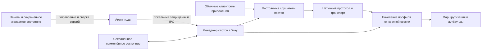

> Исторический журнал проектирования и проверок. Даты, формулировки «не выпущено» и незавершённые шаги ниже относятся к указанному этапу, а не автоматически к текущей версии. Актуальное поведение, комплект компонентов и ограничения: [сверка документации от 21 октября 2026](DOCUMENTATION-SYNC.md).

# Порты и профили Xray без перезапуска

### 17 октября — наблюдение трафика привязок (исходники, итоговый прогон впереди)

Контрольный Core возвращает cumulative uplink/downlink по UUID привязки через приватный read-only Traffic RPC. Node добавляет наблюдение в штатный system stats; панель проверяет формат и свежесть, хранит его в отдельном краткоживущем кеше. Открытие редактора не вызывает дополнительный запрос к ноде. Значения передаются как десятичные int64-строки, форматируются через BigInt и не используются для расчёта резервов. При отсутствии или устаревании измерений интерфейс показывает отсутствие данных. Уходящие привязки отображаются отдельно до завершения их соединений. Один исходный инбаунд разрешён на нескольких непересекающихся портах.

Кеш ограничен сроком system stats, максимум 120 секунд; наблюдение более чем на 30 секунд из будущего отвергается. Сбой кеша не блокирует редактор конфигурации. Эти изменения ещё не проходили единый итоговый прогон, установленная цепочка не подтверждена; выпуск не опубликован. Прежние ограничения неподключённых транспортов и перехода с общего работающего графа остаются.

Для mKCP добавлен session-aware вариант общего UDP-сокета: ключ содержит исходный адрес/порт и native conversation ID после декодирования FinalMask. Разные conversation ID с одного UDP-источника могут принадлежать разным поколениям; продолжение старого ID остаётся у прежнего профиля. Учёт удерживается до Writer.Close реального KCP-соединения и освобождается однократно. Старые и новые conversation не разделяются таймером активности. Несовместимый тип session parser на занятом endpoint отвергается до переключения. Добавлены отложенные profile_packet_session_test.go и kcp/profile_listener_test.go: первый покрывает повторное использование одного источника, второй использует настоящий DialKCP и listener. Они ещё не запускались, поэтому работоспособность этого пути не подтверждена. WireGuard/original-destination, смена несовместимых масок и переход с работающего общего Root остаются незавершёнными; полного подтверждения поддержки всех приложений нет.

Для повторного использования исходного инбаунда на разных портах добавлена миграция 20261017100000. Она снимает только прежний UNIQUE(node_uuid,config_profile_inbound_uuid) таблицы назначений; UUID назначения, связи профиля/инбаунда и единственная entitlement-связь инбаунда с нодой сохраняются. Сохранение теперь устраняет дубли только в config_profile_inbounds_to_nodes, не в отдельных назначениях портов. PostgreSQL-сценарий node-port-plans-database.integration.cjs дополнен сохранением двух портов одного инбаунда, доставкой двух независимых графов и отказом старого объединённого формата. Обновлены зависимости его compiler fixture. Сценарий и новая миграция ещё не запускались; итоговый прогон перед сборкой остаётся обязательным.

### 16 октября — уточнение основы upstream: только официальные релизы

Действующая основа: официальные теги Remnawave Backend/Frontend 3.4.5, Node 3.4.2, Subscription Page 8.0.0 и опубликованный Xray v26.10.10 (`701af60772cda123492f86e383e1fdba066614a9`, помечен авторами как prerelease). Коммиты после этого тега из main исключены, включая прежний перенос до 8703fdb и последующий до 0f3d884. Наши собственные XERA, устройства/хосты, квоты и поколения конфигурации сохраняются. Старые записи ниже о main-коммитах и их проверках описывают отменённый промежуточный вариант; они не подтверждают текущую основу. Источник актуальных возможностей и ограничений — docs/REMNAWAVE-UPDATES.md панели и метаданные официальных тегов. Сборка/выпуск ещё не выполнялись.


Проект архитектуры Remnacust от 14 октября 2026 года; статус уточнён 15 октября. Ниже сохранён целевой проект. Локально уже добавлен серверный путь применения конфигурации без перезапуска и проверены нативные TCP/UDP/Mux/XUDP/HTTP/QUIC-сценарии. В исходниках панели уже есть модель назначения профилей и inbound на порты, предпросмотр, история и интерфейс редактирования ноды. Полная независимость глобальных зависимостей профилей пока не завершена: несовместимые DNS/API/reverse и другие неподдерживаемые сочетания отклоняются. Наличие модели и интерфейса ещё не подтверждает выполнение всего целевого проекта ниже. Автоматическая выдача автономных резервов квоты панелью также ещё не включена. Изменения не опубликованы. Владелец разрешил сборку после завершения финального аудита.

## Результат для администратора и пользователя

Администратор создаёт на ноде отдельный слот подключения: один числовой порт, выбранный серверный профиль и один его inbound. Остальные порты принадлежат другим слотам. Добавление или изменение одного слота не останавливает ноду, процесс Xray или соседние подключения. Существующие соединения заканчивают работу с той конфигурацией, с которой они начались.

Слово «туннель» в интерфейсе обозначает серверную единицу управления. Клиент не устанавливает новый туннель к панели. Он подключается напрямую к публичному адресу ноды привычным протоколом.

Поддержка клиентов строится на сохранении существующего сетевого протокола. Нельзя требовать нашего приложения, дополнительного SDK, особого поля в подписке, нестандартного HTTP-заголовка или запроса к панели при VPN-подключении. Если приложение уже поддерживает выбранный протокол и транспорт, управление слотами не должно требовать его обновления. Приложение, которое вообще не поддерживает этот транспорт, система слотов не сможет сделать совместимым.

Смена публичного порта или несовместимых параметров транспорта требует новой подписки у клиента. Пока клиент использует старый адрес, старый слот сохраняется. Это переход с одновременной работой двух адресов, а не обещание незаметно перенести существующий сокет на другой порт.

## Что проверено в текущих исходниках

| Место | Текущее поведение | Значение для новой системы |
|---|---|---|
| `node/src/modules/internal/internal.service.ts`, `isNeedRestartCore` | Изменение базового хеша, количества inbound и их состояния требует перезапуска | Для управляемых слотов нужен отдельный путь применения |
| `node/src/modules/xray-core/xray.service.ts` | Запуск и смена ядра управляют общим процессом | Применение профиля нельзя направлять в этот путь |
| `xray/app/proxyman/command/command.go` | Есть AddInbound и RemoveInbound | Добавление слушателя возможно, но удаление не является безопасным переключением |
| `xray/app/proxyman/inbound/inbound.go` | RemoveHandler вызывает Close обработчика | Активные ресурсы нельзя закрывать в момент смены поколения |
| `xray/app/proxyman/inbound/always.go` | Close закрывает workers, mux и proxy | Простого сохранения TCP-сокета недостаточно для мультиплексированных соединений |
| `xray/transport/internet/grpc/hub.go` | Close вызывает Stop gRPC-сервера | Нужна сохранённая жизнь существующих gRPC-каналов |
| `xray/transport/internet/splithttp/hub.go` | HTTP/3 закрывается вместе с сервером | HTTP/3 и XHTTP-сессии требуют отдельного учёта |
| `xray/transport/internet/hysteria/hub.go` | Закрываются QUIC listener, transport и packet socket | UDP/QUIC нельзя заменить схемой Remove/Add |
| `node/src/modules/xray-core/node-reconciliation.service.ts` | Нода запрашивает актуальное состояние после потери связи, подтверждение очереди не считается применением | Этот принцип сохраняется; подтверждается фактический commit |
| `xray/core/xray.go` | Сервер описан как единый экземпляр | Нельзя без отдельного аудита создавать по полноценному core.Instance на каждый порт |

Следствие: новая система должна быть частью управления ресурсами Xray. Внешний универсальный TCP-прокси не решает UDP, QUIC и составные HTTP-сессии, а также может потерять исходный IP клиента. Это не выбранная архитектура.

## Состав системы



Панель хранит желаемую конфигурацию и задания. Агент ноды синхронизирует её с ядром. Менеджер слотов находится внутри одного процесса Xray и владеет жизненным циклом слушателей, профилей и активных сессий.

Общий процесс Xray не перезапускается при применении слота. Профиль представлен отдельным набором зависимостей маршрутизации, аутбаундов и необходимых настроек. Не создаётся второй полноценный сервер Xray через core.New без аудита глобального состояния. Счётчики, лимиты, проверка доступа и управляемые сетевые слушатели остаются общими.

## Модель слота

Панель вводит модель `NodePortBinding`:

| Поле | Назначение |
|---|---|
| `uuid` | Постоянная идентичность слота |
| `nodeUuid` | Владелец слота |
| `configProfileUuid` | Выбранный серверный профиль |
| `configProfileInboundUuid` | Конкретный inbound этого профиля |
| `listenAddress` | Интерфейс прослушивания |
| `port` | Один порт от 1 до 65535 |
| `networks` | TCP, UDP или оба на одном числовом порту, если это требуется протоколу |
| `desiredRevision` | Версия желаемой конфигурации |
| `appliedRevision` | Последняя подтверждённая применённая версия |
| `state` | Подготовка, активен, переход, завершается или ошибка |
| `retiredAt` | Запрошено снятие адреса с использования; это не принудительное отключение |

Конфликт проверяется по адресу, семейству IP, сети и порту. Wildcard-адреса, IPv4/IPv6 и режим dual-stack учитываются, чтобы не допустить два пересекающихся владельца слушателя. TCP и UDP одного числового порта разрешены для одного слота; один порт не означает ограничение клиентского UDP-трафика.

Серверный профиль может использоваться несколькими слотами. Если в нём указан диапазон портов, панель показывает явное разбиение на отдельные слоты перед применением. Служебные API-порты, Unix sockets, TUN и transparent interception не преобразуются в публичные VPN-слоты автоматически.

Произвольные другие inbound профиля не открываются вместе с выбранным портом. Выбранный inbound и его зависимости компилируются в конкретный слот. Остальные слоты сохраняют свои профили.

Назначение слотов не заменяет squads, доступ к хостам и HWID. Идентичность исходного inbound сохраняется для существующих правил доступа; внутренние имена поколений не попадают в подписку клиента.

## Постоянный слушатель и поколения профиля

Каждый слот имеет постоянный слушатель и активное поколение профиля. Конфигурация поколения неизменна после активации.

При создании новой логической сессии ядро выбирает поколение и сохраняет ссылку на него в контексте сессии. Последующие операции этой сессии используют то же поколение. Обновление активного указателя не меняет контекст уже работающей сессии.

Старое поколение становится завершающимся. Его аутбаунды, DNS-зависимости, mux и другие ресурсы закрываются только после освобождения всех зависимых сессий. Не вызываются Close всего inbound, grpc.Server.Stop, HTTP/3 Close или закрытие общего UDP socket в момент переключения.

Маршрутизация, DNS и аутбаунды поколения разрешаются через локальный набор зависимостей профиля. Общие функции Xray, которым нужны пользовательские лимиты и учёт, используют один общий экземпляр состояния. Внутренние теги аутбаундов изолируются по слоту и поколению; ссылки в правилах, балансерах, наблюдении и цепочках приводятся к этому пространству имён. Исходный пользовательский JSON и названия для клиента сохраняются отдельно.

По умолчанию нет таймера, который насильно уничтожает работающие соединения старого поколения. Граница удаления — окончание сессий и обычные таймауты самого протокола. Для UDP без формального закрытия учитываются активность и существующий протокольный idle timeout.

Нужно ограничение числа удерживаемых поколений. При его достижении новое изменение остаётся ожидающим, а не отключает клиентов ради освобождения памяти. Интерфейс показывает, какой слот удерживает старые сессии. Принудительное завершение — отдельная явно подтверждаемая операция с указанием затрагиваемого слота и количества сессий.

## Что меняется без разрыва

| Изменение | Действие |
|---|---|
| Добавлен новый порт | Подготовить и открыть только новый слушатель; действующие не закрывать |
| Изменены маршруты, DNS или аутбаунды профиля | Создать поколение; существующие сессии сохраняют старые зависимости |
| Изменено название или описание | Изменить метаданные, без операции с трафиком |
| Добавлен пользователь | Обновить локальное состояние доступа, без перезапуска |
| Изменены лимиты | Обновить общее состояние ограничения для всех поколений |
| Удалён порт | Убрать из новой выдачи; сохранить до завершения перехода и существующих сессий |
| Изменён публичный порт | Создать новый слот; старый адрес работает до завершения миграции клиентов |
| Изменены несовместимые сетевые параметры | Отдельный слот/адрес перехода; автоматического Remove/Add на занятом порту нет |
| Отозван доступ или заблокировано устройство | Применить отзыв во всех поколениях; требуемое разрывание отозванных сессий остаётся отдельным действием безопасности |
| Обновлён исполняемый файл ядра или произошёл сбой хоста | Отдельный жизненный цикл; это не горячая смена профиля |

Нельзя обещать, что смена протокола, REALITY-ключа, схемы шифрования, маскировки или сетевых параметров всегда совместима на одном адресе. Классификатор сравнивает конфигурации. Непроверенное изменение считается несовместимым и планируется как переход на новый слот. Если можно сохранить старую совместимость посредством нативного адаптера, это включается только после тестов конкретного транспорта.

Самовольно переходить к остановке общего ядра при ошибке горячего применения запрещено. Нода возвращает причину и сохраняет работающую конфигурацию.

## TCP UDP и составные транспорты

### Обычные TCP-подключения

Сохраняются реальные socket и адрес клиента. Сессия владеет ссылкой на поколение до окончательного закрытия. Обновление соседнего порта никак её не затрагивает. Нельзя добавлять L4 forwarding через локальный адрес с потерей RemoteAddr ради упрощения.

### Mux и XUDP

Физический carrier и логические потоки учитываются раздельно. Нельзя освобождать поколение по отсутствию обычного TCP-потока, пока его использует mux. Существующие потоки сохраняют маршруты и ограничения. Новые потоки проверяются по актуальному доступу, а не по бесконечно старому списку пользователей carrier.

### WebSocket HTTPUpgrade и gRPC

Сохраняются действующие upgraded-соединения и HTTP/2 carriers. Старый gRPC-server не останавливается при обычной смене профиля. Его остановка допустима лишь после завершения зависимых каналов. Учитываются tun и multiMode, keepalive, trailer/error propagation и отмена отдельного потока.

### XHTTP и Xera HTTP

Один VPN-сеанс может состоять из отдельных uplink/downlink HTTP-запросов, новых TCP-подключений и повторных запросов. Поэтому привязки только по TCP-сокету недостаточно.

Нативный реестр связывает `(slot, sessionId, authenticatedIdentity)` с поколением. Дальнейшие части сеанса направляются к нему независимо от того, через какое транспортное соединение пришли. Новый случайный запрос не может подобрать sessionId и присоединиться к чужому контексту. Потерянный или неподдерживаемый sessionId не получает доступ за счёт fallback.

Проверяются packet-up, stream-up, stream-one, согласованные режимы, HTTP/1.1, HTTP/2, HTTP/3, раздельные адреса uplink/downlink, прокси/CDN и имеющиеся расширения нашего транспорта. Изменение пути, схемы или несовместимого шифрования направляется через переход адресов, чтобы клиент со старой подпиской мог закончить работу.

### QUIC HTTP/3 и Hysteria

Сохраняется нативный packet socket, transport, QUIC connection и его Connection ID. Новые streams уже открытого QUIC-сеанса не теряют владельца. NAT rebinding и migration должны сохранять привязку к тому же сеансу; маршрутизация только по паре IP:port этому требованию не соответствует.

Если адаптеру требуется разделение серверных поколений QUIC, оно выполняется через стандартные непрозрачные Connection ID и поддержку самого QUIC-движка. Это не новая настройка клиента. Пассивный UDP-посредник не может надёжно узнать все новые CID из зашифрованных управляющих frames, поэтому такой посредник не используется.

### Обычный UDP и mKCP

Используются нативные идентификаторы conversation/session; существующая таблица потоков сохраняется. Для stateless UDP сохраняется корректная привязка потока и обычный idle timeout. Учитываются исходный адрес, destination, cone/NAT-режимы и направление ответа. Переключение с использованием нескольких UDP sockets и одного SO_REUSEPORT не считается доказательством сохранения сессии: изменение состава sockets может перераспределить существующие пакеты.

## Работа без панели

Трафик не идёт через панель. На ноде остаются применённые профили, валидаторы пользователей, политики доступа, ограничения и необходимые файлы. Потеря API-связи не вызывает остановку ядра, закрытие слотов или уничтожение старых поколений.

Нода продолжает принимать подключения с уже выданными действительными данными. Срок подписки и локальные ограничения продолжают соблюдаться. Квота не становится безлимитной из-за недоступности панели. Новая регистрация устройства, требующая серверного разрешения и выдачи персональных данных, не обходится с помощью общих ключей: до связи с панелью используются уже разрешённые устройства.

Желаемое и фактически применённое состояния хранятся раздельно. Последнее применённое состояние записывается атомарно и восстанавливается при старте. Изолированные ошибки одного сохранённого слота не удаляют остальные. Повреждённое состояние не заменяет последний корректный снимок пустой конфигурацией.

Сверка с панелью использует таймаут, backoff с jitter и одну операцию одновременно. После восстановления связи сравниваются версии и хеши. Одинаковые состояния подтверждаются без повторного применения. Принятие задания в очередь не является подтверждением того, что порт уже работает.

Необратимые отзывы доступа хранятся отдельно от временных версий профиля. Восстановление старой конфигурации или базы не должно случайно возвращать удалённые права. Смена authority epoch после восстановления панели требует явной процедуры согласования, а не принятия любого меньшего номера ревизии.

## Транзакция применения

1. Панель сохраняет новую желаемую ревизию. Откат истории создаёт новую ревизию, номер не уменьшается.
2. Нода проверяет полномочия, node identity, версию, хеш, схему и поддерживаемые capabilities ядра.
3. Менеджер компилирует все затронутые поколения и проверяет полный набор зависимостей. Неподдерживаемый протокол или отсутствие адаптера не превращаются в конфигурацию «по умолчанию».
4. Для новых портов резервируются sockets без закрытия существующих. Конфликт bind прерывает подготовку.
5. Все новые поколения проходят readiness. Асинхронный старт gRPC/HTTP не считается успешным до подтверждения реального слушателя.
6. Записывается и fsync-ится журнал намерения commit вместе с новым проверенным снимком и ссылкой на предыдущий.
7. Активные указатели затронутых слотов переключаются атомарно. При аварии между записью намерения и переключением журнал однозначно задаёт, какое проверенное состояние восстановить.
8. Сохраняется applied state и подтверждается commit. Только затем панель обновляет appliedRevision и показывает успешное применение.
9. Старые поколения завершаются по фактическому освобождению сессий. После этого удаляются их ресурсы.

До commit ошибка закрывает только подготовленные новые ресурсы. Существующие слушатели и соединения остаются. До необратимого действия всегда есть корректный сохранённый снимок. Ошибка освобождения старого поколения после commit отражается как незавершённая уборка, а не как ложный откат уже работающей новой конфигурации.

Повторный operationId с тем же хешем возвращает прежний результат. Тот же operationId с другим хешем отклоняется. Stale revision не применяется. Параллельные изменения одной ноды сериализуются. Отмена до commit удаляет подготовку; после commit это отдельное новое изменение.

## Управляющий контракт

Это предлагаемый новый контракт, которого ещё нет в текущем API:

```json
{
  "schemaVersion": 1,
  "nodeUuid": "10000000-0000-4000-8000-000000000001",
  "authorityEpoch": "10000000-0000-4000-8000-000000000002",
  "operationId": "10000000-0000-4000-8000-000000000003",
  "revision": "42",
  "expectedAppliedRevision": "41",
  "bindings": [
    {
      "uuid": "10000000-0000-4000-8000-000000000004",
      "profileUuid": "10000000-0000-4000-8000-000000000005",
      "inboundUuid": "10000000-0000-4000-8000-000000000006",
      "listen": "0.0.0.0",
      "port": 443,
      "networks": ["tcp"],
      "profileHash": "sha256:<canonical-profile-hash>",
      "desiredState": "active"
    }
  ]
}
```

Профиль передаётся в отдельном проверяемом snapshot и включает необходимые зависимости. Версии и идентификаторы отделены от содержимого с секретами. Status не выводит ключи, списки пользователей или полный профиль.

Core capabilities возвращают не только общий флаг hot reload, но и поддерживаемые операции конкретных протоколов и транспортов. На старой ноде UI не показывает безопасное применение как доступное. Неизвестная capability означает отсутствие гарантии, а не разрешение перезапуска.

Действия управления: подготовить, применить подготовленное, отменить подготовку, запросить состояние, завершить переход, принудительно отключить выбранный слот. Последнее действие отделено от обычного сохранения и требует свежей авторизации администратора.

IPC остаётся локальным через защищённый Unix socket. Нода не открывает публичное API Xray. Проверяются peer identity/права socket, размеры запросов, operationId и принадлежность ноде. Панель проверяет JWT/роли/права при каждом изменении; чтение истории или статуса не предоставляет право изменять трафик.

## Учёт доступа и трафика

Все поколения используют одну авторитетную политику для пользователя, устройства, хоста и тега. Создание нового поколения не удваивает лимит скорости или доступную квоту.

Идентичность хоста и устройства привязывается при аутентификации и сохраняется для всей сессии. Переименование тега, профиля или поколения не переносит уже учтённый трафик на другого владельца. Глобальные пользовательские, host-wide и tag-wide ограничения учитывают одновременно старые и новые сессии.

Счётчики монотонны и продолжаются через переключение. При выгрузке поколения его накопленные значения сначала учитываются, а затем освобождаются. Повторная отправка receipt не прибавляет трафик второй раз. Очередь недоставленных итогов сохраняется локально; offline-журнал хранит агрегаты, а не запись каждого пакета. Очистка диагностических логов не удаляет данные расчёта квоты.

Блокировка HWID и отзыв доступа охватывают все поколения. Обычное изменение профиля не используется вместо адресного отзыва. Нельзя сохранять старое право только потому, что старое поколение ещё обслуживает другие сессии.

## Применение из интерфейса

В карточке ноды появляется список слотов с портом, протоколом, профилем, активной ревизией, состоянием перехода и числом активных сессий. Для отдельного слота можно создать порт, выбрать профиль/inbound, посмотреть план изменения, применить или открыть историю.

Перед сохранением UI показывает классификацию: горячее применение на текущем адресе, добавление нового адреса для перехода или операция, требующая обслуживания. При обычном сохранении пользователь не получает скрытый массовый рестарт.

На телефоне слоты показываются карточками с отдельным портом и понятными действиями. Форма и JSON используют общий черновик. Показаны конкретные добавления и изменения. История профиля и история привязки сохраняются раздельно: восстановление старого текста профиля не присваивает ноде неизвестный порт автоматически.

В состоянии «панель недоступна» различаются недоступность управления и состояние трафика. Отсутствие свежего отчёта не подписывается как «все соединения остановлены».

## Нода и ядро при обновлении контейнеров

Применение профиля не является обновлением бинарного файла. Текущий node container содержит управляемый процесс Xray, поэтому пересоздание такого контейнера нельзя называть обновлением без разрыва сеансов.

Для независимости от перезапуска агента нужен отдельный долгоживущий сервис data plane и общий приватный control socket. Агент можно обновлять, сохраняя живой core service. Установщик и Compose должны различать эти сервисы; основной агент не получает владение публичными sockets.

Первая миграция уже работающего процесса на новую архитектуру не может передать произвольное TLS/QUIC-состояние чужому новому процессу. Для неё нужен согласованный переход: старые подключения обслуживаются прежним процессом до завершения, новые адреса добавляются отдельно. Если требуется сохранить тот же адрес при первой замене бинарного файла, нужен отдельный проверенный механизм передачи состояния или окно обслуживания. Скрытого kill/restart нет.

Будущая замена исполняемого файла ядра проверяется отдельно. Она не входит в гарантию горячего применения профилей. Образы и контейнеры, ещё обслуживающие старые сессии, защищаются от новой очистки; зачистка старых поколений выполняется только после подтверждённого завершения.

## Миграции и совместимость данных

Новая миграция добавляет таблицу привязок и версии состояния. Ранее опубликованные миграции не редактируются. Существующая единственная привязка профиля ноды сохраняется как legacy/default.

Legacy host/inbound UUID сохраняются. На первом включении формируется план портов с проверкой конфликтов и списком зависимостей. Пока нода и ядро не подтвердили capabilities, существующая конфигурация не преобразуется автоматически.

Авторизация по squads, фильтрация скрытых хостов, персональные данные устройств, лимиты и текущие шаблоны подписок проверяются и для новых привязок. Шаблон автоселектора клиента не подменяет серверный профиль слота.

Резервная копия включает привязки и желаемые конфигурации. Восстановление базы создаёт новый authority epoch и процедуру согласования с фактическим состоянием нод. Оно не отправляет незаметно устаревшие права или уничтожающий трафик пустой список слотов.

## Пределы ресурсов и обработка ошибок

Нужны ограничения числа слотов, подготовленных транзакций, живых поколений, handshake-очередей, session registry и буферов. Значения конфигурируются, а не зашиваются в условия бизнес-логики. Измеряются память, открытые file descriptors, размер очередей и время подготовки.

Переполнение отклоняет новое изменение или новую сессию с понятной причиной. Работающая сессия не удаляется ради выполнения очередного сохранения. Имена ошибок должны различать конфликт порта, несовместимый транспорт, неподдерживаемый core, нехватку ресурсов, stale revision, ошибку сохранения и незавершённую очистку.

Таймаут относится к подготовке и управляющему запросу. Он не становится таймаутом жизни уже работающего профиля. Idle timeout самого протокола сохраняет своё назначение.

## Проверки перед включением

| Проверка | Критерий приёмки |
|---|---|
| Новый порт при работающих остальных | PID ядра и агента не меняются; соседний поток непрерывен |
| Изменён профиль одного слота | Старый TCP/mux поток работает; новые сессии получают новую ревизию |
| gRPC и WebSocket | Действующие каналы и потоки не закрыты; корректно завершаются сами |
| XHTTP/Xera HTTP | Параллельные uplink/downlink и повторные запросы не потеряли session owner |
| HTTP/3/Hysteria | QUIC CID, migration и NAT rebinding продолжают действующий сеанс |
| UDP/mKCP/XUDP | Ответы, conversations, NAT и обычные idle timeout не изменились |
| Одинаковые UUID на разных допустимых слотах | Доступ, статистика и квоты относятся к правильному хосту |
| Блокировка устройства | Отзыв охватил активные и завершающиеся поколения |
| Панель отключена | Подключения с выданными действительными данными продолжаются; локальные лимиты действуют |
| Связь восстановлена | Сверка без лишнего применения и перезапуска; ACK только после commit |
| Ошибка bind или невалидный JSON | Старые профили, порты и соединения не изменились |
| Повторный запрос или конкурирующие ревизии | Нет двойного применения, отката к stale state или потери нового изменения |
| Disk full и авария во время commit | Восстанавливается определённый корректный снимок; нет ложного успешного ACK |
| Откат профиля | Создаётся новая ревизия; отозванные права не оживают |
| Обычное обновление агента | Отдельный core service продолжает работать |
| Очистка образов | Data plane и удерживаемые поколения не удаляются |

Матрица клиентов включает семейства Xray/v2rayN/Throne, sing-box, Mihomo/Clash, Happ/INCY и мобильные приложения через поддерживаемые ими обычные форматы. Проверяется конкретная поддерживаемая комбинация протокола и транспорта, а не только импорт подписки. iOS, Android, Windows, macOS и Linux проверяются отдельно.

Для каждой комбинации нужно длительное живое соединение, непрерывная нумерованная передача данных, изменение профиля, параллельное новое подключение и выключенная панель. Считаются потерянные/повторные сообщения, ошибка протокола, PID и фактическая ревизия. Успешный ответ API или одинаковый PID сами по себе не доказывают отсутствие разрыва.

Отдельно нужны race-тесты ядра, fuzz входящих кадров и конкурирующих транзакций, тесты rollback/migrations и длительные проверки утечек после многих поколений. Пока матрица нативных транспортов не проходит, возможность не включается по умолчанию и не объявляется поддержкой всех приложений.

## Последовательность реализации

1. Менеджер слотов и транзакций в ядре: состояния, версии, компиляция, ресурсы, локальная durability и снимки. Нативные адаптеры доступа и транспорта, без смены общего процесса.
2. Владение поколениями для сессий и отдельная проверка TCP, mux, gRPC, WebSocket, HTTPUpgrade, XHTTP, HTTP/3, Hysteria, UDP и mKCP. Без общей схемы Remove/Add.
3. Capability API ядра и агент ноды с сохранением desired/applied состояния, idempotency и offline reconciliation. Глобальные ограничения и traffic receipts.
4. Миграция панели, привязки профилей к портам, серверная проверка доступа и GUI с предварительным планом. Сохранение прежних хостов и подписок.
5. Отделение data plane от агента в установщике и Compose; защита живых поколений в обновлении и очистке. Проверенный переход существующих установок.
6. Полная матрица живых клиентов и миграций. Только затем включение и сборка выпуска.

Это новая архитектура, а не маскировка рестарта. До её внедрения действуют текущие механизмы ноды и ядра; их поведение этим документом не изменено.


## Проверенная локальная реализация на 15 октября

- Ядро принимает целую конфигурацию через локальный защищённый gRPC и оптимистическую проверку исходного хеша. Новые слушатели сначала проверяются и открываются без допуска трафика; ошибка bind не заменяет действующую конфигурацию.
- Действующие соединения удерживают своё поколение маршрутов/аутбаундов. Новые TCP/Unix-сессии, UDP-ассоциации и логические Mux/XUDP-потоки получают актуальное поколение. Клиентский протокол не расширяется.
- Уже занятый тег/порт и несовместимая замена параметров того же слушателя требуют явного переноса или обслуживания. Полный рестарт не используется как скрытый fallback после ошибки hot apply.
- Применённая конфигурация сохраняется приватным контрольным файлом с проверкой целостности; при старте перевыпускаются только внутренние сокеты и токен управления ноды. Изменение публичного клиентского адреса не маскируется под сохранение прежнего сокета.
- Нода восстанавливает сохранённый выбор ядра и административную паузу до открытия публичных слушателей. Установщик подготовлен к переносу состояния старого остановленного контейнера в постоянные каталоги без очистки оригинала.
- Эти пункты проверены исходниками и синтетическими тестами с нативными клиентами ядра. Испытаний всех сторонних приложений и WAN-нагрузки это не заменяет.

## Автономные квоты: выбранный подход и незавершённые части

Владелец выбрал локальные резервы. Панель должна заранее выделять ноде конечный остаток по пользователю и области квоты. Отсутствие панели не прекращает разрешённый трафик до исчерпания этого остатка или окончания периода/права доступа. Общие квоты хоста и тега проверяются вместе; upload/download и устройства используют общий бюджет.

Локально реализованы проверка грантов ядром, приватный журнал с SHA-256 каждой записи и последовательностями, дописывание только изменённых грантов и периодическое атомарное сжатие журнала. Перед пропуском байтов на диск синхронно записывается верхняя граница списания. После аварии неиспользованная часть записанного блока до 1 MiB на активный грант считается потраченной: это консервативная защита от повторной выдачи, а не доказательство фактического трафика. Коэффициент применяется в сотых; дробные доли накапливаются между пакетами и устройствами, округляется совокупный расход. Разбиение одного буфера на мелкие пакеты не должно менять списание.

Отсутствующий/повреждённый активный журнал и незавершённая запись закрывают защищённый трафик. Журнал не является средством восстановления потерянного резерва из старой копии. Восстановление и перенос требуют согласования с панелью; их нельзя выполнять обнулением файла.

Миграция `20261015010000_offline_quota_reservations` и начальная SQL-функция распределяют известный остаток между нодами, сохраняют гранты при потере ответа и не освобождают их при удалении ноды. Они проверены на отдельной PostgreSQL. Начальная функция НЕ реализует перераспределение уже выданных грантов при RESET/ADD или изменении списка нод.

Каждый грант связан с постоянным UUID экземпляра ноды. Повторная установка с пустым журналом получает другой UUID и не вправе получить прежний остаток повторно. Нода сохраняет монотонную ревизию политики и отклоняет запоздавшие запросы, повторное использование ревизии для другого содержимого и незаметное выключение режима резервов. Сам грант регистрируется на диске до ACK, даже когда его ещё никто не использовал.

Отзыв гранта необратим: ядро сначала сохраняет закрытую запись с окончательным списанием. При штатном закрытии это фактический учтённый расход; после аварии — консервативное списание записанного заранее блока. Закрытый грант не открывается повторно. Защищённый JWT endpoint ноды возвращает ограниченный по размеру снимок журнала только после ACK работающего ядра; рестарт ядра или смена политики во время чтения отменяют подтверждение. Отсутствующая запись возвращается явно и не считается нулевым расходом.

SQL-функция подтверждения закрытия проверяет ноду, её UUID экземпляра, владельца, область, потолок, срок и закоммиченную ревизию. Повторы не удваивают возврат. Функция начальной выдачи больше не возвращает уже закрытый грант. Автоматическое перераспределение освобождённого остатка пока не подключено.

Отдельная SQL-функция перераспределения уже реализована и проверена: она вычитает из исходного бюджета прежний долг, полные потолки активных грантов и окончательные расходы закрытых. На недоступной ноде активный потолок остаётся занят полностью. Подтверждённый неиспользованный остаток распределяется детерминированно; активный грант растёт с тем же ID, после закрытия нужен новый ID. Идемпотентный ID операции не позволяет старому повтору забрать остаток, освободившийся позже. Отказ привязки одного участника откатывает всю операцию. Сумма расходов и действующих резервов не превышает исходного бюджета пула; изменение лимита в БД само по себе не увеличивает этот бюджет.

Если увеличение потолка закоммичено, но ответ не дошёл до ноды, подтверждённое необратимое закрытие с прежним меньшим потолком тоже допустимо. Оно не может заявлять расход выше применённого нодой потолка. Поздняя доставка увеличения уже закрытого гранта отклоняется ядром. Планировщик панели каждые 10 секунд собирает подтверждения только по уже выданным живым резервам, ограниченными порциями по 500 записей. Отсутствующие и активные записи не освобождают квоту; старые ноды без резервов не получают этот запрос. Первичная автоматическая выдача и выполнение RESET/ADD ещё не подключены.

В этой же новой миграции удалены каскадные связи с нодой из четырёх таблиц учёта квот и подтверждений расхода. Числовой ID удалённой ноды остаётся историческим источником записи. Удаление ноды больше не стирает потраченный трафик и не обнуляет долг хоста/тега. Проверены сохранение всех четырёх журналов и прежнего взвешенного значения `xera_limit_state` после реального DELETE. Уже потерянные до миграции записи автоматически не восстанавливаются.

Новые ноды объявляют поддержку ревизий политики. Для них панель завершает SQL-транзакцию с выделением ревизии перед HTTP-доставкой; ошибка коммита не отправляет политику. Старые ноды сохраняют доставку под блокировкой. Синхронизация из ещё открытой внешней транзакции отклоняется, чтобы не отправить незафиксированные права. Возможности кэшируются на 60 секунд с привязкой к адресу соединения; после неудачной доставки кэш сбрасывается. Ручное включение автономной политики вне незавершённого координатора не приводит к её незаметной замене legacy-политикой: возвращается явный отказ.

В ядре реализован мягкий барьер `fenceAll` / `fencedOwners`. Он задерживает новые порции данных выбранного хоста/владельца, не закрывая соединение. Уже допущенная порция завершает запись журнала и счётчика до публикации новой политики. Диск не удерживает общий mutex политики; незатронутый хост продолжает работу. После снятия барьера ожидавшая порция возобновляется. Отмена контекста, окончание права доступа, отзыв устройства и остановка корневого Xray освобождают ожидание. Обычное завершение отправки не отменяет обратное направление соединения.

Барьер требует отдельной capability `remnacust-quota-fences-v1` и её подтверждения работающим ядром. Агент, менеджер ядра, bootstrap и проверка образа установщика запрещают ядро, которое проигнорирует сохранённый переход. Пройдены Linux race и реальный VLESS-тест с паузой/возобновлением того же сокета и живым соседним портом. Это ещё не готовая распределённая транзакция: постоянный барьер сам не принимает решения о сбросе и не отменяется по таймауту панели.

До реализации координатора остаётся решить семантику RESET при недоступных нодах: применять новый бюджет постепенно (недоступная нода пока тратит прежний резерв) или оставлять весь сброс в ожидании до связи со всеми участниками. Выбор влияет на общий остаток в переходный период. Вопрос задан владельцу; автоматический вариант пока не выбран.

Для безопасного перехода со старых счётчиков их изменение перенесено внутрь допуска трафика. После подтверждённой блокировки старый расход больше не появляется поздно. Сбор статистики сериализует сброс RAM-счётчиков и фиксацию расхода отдельной ноды в PostgreSQL, включая повтор зависшего задания другим обработчиком. Redis-подтверждение удаляется только после успешного коммита; отметка свежести содержит время начала запроса по часам БД. Это основа будущего перехода, а не автоматическое включение резервов.

В отдельном Docker-тесте с настоящим VLESS два соединения исчерпали один общий резерв при уже истёкшем TTL панели; пятый ответ был отклонён, соседний порт остался рабочим, закрытие сохранило окончательное списание. Это проверка нативного ядра в изоляции, не всей цепочки panel → node и не всех клиентских приложений.

Обновление и откат установщика используют один и тот же новый постоянный журнал: образ возвращается к предыдущему, но потраченная после обновления квота не откатывается. Снимок прежнего остановленного контейнера извлекается потоково с ограничениями размера/числа файлов и отказом ссылок/спецфайлов. Перед запуском выбранного образа проверяется поддержка сохранённого режима резервов; несовместимый образ не запускает публичное ядро. Эти проверки пройдены на одноразовых Docker-контейнерах.

Блокирующие задачи до включения и выпуска: согласованный переход с прежних RAM-счётчиков, подтверждённое ограничение всех участников перед первой выдачей, доставка только ПОСЛЕ коммита БД, ручные операции с квотой и безопасный перенос неиспользованного резерва. До завершения этих частей обычный HostPolicyService продолжает прежний путь с TTL; наличие нового кода ядра само по себе не включает автономность.


## Обновление 2026-10-15: повторный сброс и удобство применения

Владелец выбрал немедленный RESET для доступных нод. Офлайн-нода продолжает расходовать прежний резерв и получает новую политику при подключении. Во время перехода сумма действующих старых и новых резервов может временно превышать новую общую квоту; это согласованное поведение.

В неопубликованную миграцию резервов добавлены версии бюджета `budget_epoch`, текущая версия для владельца/области/периода, идемпотентные операции изменения и состояния желаемого/подтверждённого применения на нодах. RESET открывает отдельный бюджет в том же периоде. Старые гранты не считаются закрытыми из-за отсутствия ноды; поздний возврат старой версии не пополняет новую. ADD увеличивает только текущий бюджет и не меняет ID уже действующего гранта. SQL-изменения входят в одну транзакцию с LimitsService; отказ коммита не запускает доставку. Область без первоначальной выдачи остаётся на прежнем счётчике: преждевременный бюджет не создаётся.

HostPolicyService формирует автономную политику только для нод, зарегистрированных в таблице координатора. Он передаёт текущие гранты, срок действия обычной подписки, коэффициенты в сотых и самостоятельные паузы/личный безлимит. Публичные recovery-hosts сохраняют явно настроенное исключение для неактивной подписки. Режим без SQL-регистрации или с другой локальной instance UUID по-прежнему отказывается принимать неявную замену. ACK фиксируется только после `applied` работающего ядра; `staged` подтверждением не является. Мягкий барьер сохраняет действующие гранты, не закрывая их только из-за подготовки перехода.

На странице лимитов добавлен статус сброса с числом применивших нод и раскрываемым списком ожидающих. Список ограничен 50 именами в ответе и высотой 180 px в интерфейсе; оставшееся число показано отдельно. Состояние хранится в SQL и переживает повторное открытие страницы. Новая ревизия политики с уже применённой версией бюджета не возвращает статус в ожидание. Пояснение о прежних резервах показывается при недоступных участниках. Есть EN/RU/FA/ZH, клавиатурное раскрытие, вежливое объявление изменения статуса и безопасный перенос длинных названий.

Подтверждено локально:

- 425 backend-тестов: 421 PASS, 4 SKIP, 0 FAIL; 22 целевые проверки доставки/формирования политики также прошли.
- 157 миграций применены с нуля к двум отдельным тестовым БД. 20 групп банковских сценариев прошли, включая фактическую Prisma/Kysely-доставку HostPolicyService и прогресс для одной доступной и одной отключённой ноды. Отдельный LimitsService integration подтвердил RESET/ADD, повтор ID запроса и откат неудачного коммита.
- Реальный Chrome: компонент в состояниях ожидания/готовности, Enter на раскрытии, 320/375/430/768/1024/1440 px без горизонтального переполнения с 50 длинными названиями. Все четыре языка отдельно проверены при 320 px, включая RTL. Это компонентный dev-fixture с тестовыми данными, не авторизованный сквозной прогон рабочей панели.
- Проверки типов backend/frontend и целевые линтеры прошли; локализации: 2515 ключей и 3755 статических вызовов.

**Остаётся NOT READY.** Автоматический координатор первого перехода и выдачи грантов ещё не завершён; новый режим не включается автоматически этим изменением. Не завершены автоматическая доставка RESET/ADD всем участникам, членство и переходы личного безлимита, восстановление более старой БД с неизвестными действующими резервами, полный panel → node → Xray E2E, документация всех поверхностей и production-сборка. Технический статус и компоненты UI не означают завершение этих задач. Production-сборки, публикации и изменений рабочего сервера в этом шаге не было.


### Подтверждение процесса и устранение побочного эффекта CLI

Добавлена capability `remnacust-core-incarnation-v1` и случайный `coreProcessId`, неизменный в пределах процесса Xray. Нода проверяет ограниченный файл статуса до и после чтения счётчиков; при смене/отсутствии метки возвращает `coreProcessId: null`, сохраняя сами данные расхода. Регулярный файл проверяется до открытия, используются no-follow/non-blocking флаги и сверка inode. FIFO, каталог, ссылка, чрезмерный или повреждённый файл не должны блокировать статистику. Панель сохраняет валидную метку вместе с временем уже закоммиченного сбора; новый процесс меняет границу подтверждённого барьера. Это ещё не долговечный протокол переноса исходного расхода.

Обнаружен и исправлен побочный эффект загрузки Go-пакета: служебный процесс мог читать политику и перезаписывать `host-policy.status.json` со своим PID. Загрузчик теперь запускается при подготовке диспетчера реального сервера. Все `PrepareStart` выполняются до старта слушателей root и feature scope; ошибка подготовки не запускает их. Старый ACK удаляется перед реальным стартом, защищая от повторного PID. CLI без экземпляра сервера не трогает ACK. Для клиентских платформ и обычного Linux-клиента серверный watcher не включается; Node image явно устанавливает `REMNACUST_NODE_RUNTIME=1`, а старые образы с core-manager и Linux-установки с файлом политики сохраняют совместимость.

Проверено: 39/39 тестов Linux-ноды, включая повреждённый статус, повторный PID, смену процесса во время сбора и отказ открывать FIFO. Windows-проверка нового helper: 4 PASS/1 platform SKIP; первая попытка уборки временной папки столкнулась с ENOTEMPTY, добавлен ограниченный retry и папка убрана. Это не полный Windows E2E ноды. 148 тестов интерфейса прошли. Go race: dispatcher, runtime command, inbound, Mux; отдельные тесты порядка подготовки root/scope; изолированная проверка неизменности ACK после запуска CLI-подобного процесса. Настоящий VLESS повторно прошёл старт с сохранённой политикой, общий конечный резерв, паузу/возобновление того же сокета и работу соседнего порта. Все пять TestCommander запущены в `testing/scenarios`, прошли (42.759 s). Вызов с другим package однажды не нашёл тестов и результатом этой проверки не считается.

Сохранение действия лимитов больше не ждёт обхода всей сети: доставка запускается после коммита в фоне, однотипные запросы объединяются, а изменения во время обхода сохраняют следующий проход. Проверены пакет из 100 одновременных запросов, повторный проход и восстановление после ошибки. UI опрашивает статус каждые 3 секунды, когда есть доступные ожидающие ноды, и реже при ожидании только офлайн-участников.

Блокер повторной доставки счётчиков для зарегистрированного режима закрыт протоколом долговечных квитанций (обновление ниже). Автоматический координатор, автономный общий лимит пользователя и восстановление утраченного неподтверждённого долга остаются условиями выпуска. Успешный replay не разрешает сам по себе выдачу нового бюджета.

Перед production-билдом обязательно перепаковать source archive ядра в репозитории ноды и проверить его manifest/хеши: Docker собирает ядро из архива, а не прямо из соседнего checkout. Публикация, production-сборки и изменение рабочей инфраструктуры по-прежнему не выполнялись. Статус остаётся **NOT READY**.

## Обновление 2026-10-15: долговечные квитанции расхода

Это неопубликованный этап разработки. Он закрывает повторную доставку счётчиков для зарегистрированного режима ноды; автоматический координатор и полный автономный бюджет пользователя ещё не завершены. Сборка и публикация после финального аудита остаются впереди.

### Протокол и сохранение состояния

Ядро предоставляет `remnacust-usage-receipts-v1/Exchange` через тот же приватный gRPC API. Команда `api usage-receipt` передаёт `action`, `stream`, `sequence`, `coreProcessId`; для `ack` требуется `digest`. `stream` равен `quotaInstanceId` ноды. Последовательность и все int64-счётчики передаются десятичными строками. Nil/max UUID и неканонические числа не принимаются. Обычные клиентские протоколы не менялись.

До обнуления RAM ядро атомарно записывает приватный `/var/lib/remnanode/usage/receipt.json`: номер, исходный процесс, время, отсортированные счётчики и SHA-256. Файл ограничен 8 MiB, 100 000 ненулевых счётчиков и 1024 байтами имени; превышение отклоняется до записи и списания. SHA-256 проверяет целостность, а не шифрует файл. Не доверяются ссылки, чужие или открытые права и неподходящие типы файла. Существующие предки проверяются до создания каталогов.

Затем вычитаются ровно сохранённые значения, поэтому параллельные новые байты остаются для следующего снимка. Неподтверждённый снимок возвращается неизменным, включая после настоящего перезапуска процесса. ACK сохраняет номер и digest; повтор ACK не стирает более новый снимок. Потеря/порча журнала, другой экземпляр, неверный номер или неоднозначный fsync не превращаются в пустой расход. В неоднозначном состоянии дальнейшее списание требует восстановления. После включения потока старые destructive API не могут обнулить пользовательские счётчики за его спиной. Менеджер без сериализации статистики не может доказывать нулевой долг.

Нода добавляет JWT-защищённый `POST /node/xray/usage-receipts`, проверяет локальный экземпляр журнала и capability работающего бинарника, вызывает фиксированную команду через приватный Unix-сокет и проверяет поля/контрольную сумму ответа. Есть таймауты и лимит вывода 16 MiB; панель также ограничивает декодированный HTTP-ответ 16 MiB. При неизвестном результате нет возврата к legacy reset. CLI и ответ сохраняют точность выше 2^53.

### Панель и исходный долг

`xera_node_usage_streams` хранит один текущий номер и ограниченный pending-outbox на историческую ноду; таблица квитанций на каждый десятисекундный опрос не создаётся. Начальный запрос с ID процесса и множителем коммитится до обращения к ядру. Общий расход `user_traffic`, расход HOST и необязательная история обновляются в одной транзакции. ACK отправляется после её коммита. Потерянный ответ, отказ коммита, повтор зависшего задания или потерянный ACK не начисляют деньги дважды. Отключение статистической истории не отключает учёт HOST и общего расхода. Чтение legacy повторно проверяет смену режима под тем же блокирующим ключом до reset.

Уведомления и экспорт отделены от денежных изменений. Уведомления получают стабильный ID задания. Экспорт снабжён `receipt` и ограниченными watermark по пакетам; Lua сравнивает длинные номера строками, сохраняя точность. После потери самого Redis потребителю всё равно следует учитывать `receipt`: межсистемные уведомления не объявляются универсальным exactly-once протоколом.

Для первой выдачи отдельно сохраняется `initial_core`; новая отметка барьера не стирает его. `initial_drained_at/sequence` появляются только в транзакции учёта снимка того же исходного процесса, запрошенного строго после подтверждённого барьера по часам БД. При смене процесса без доказанного исходного долга свежий нулевой снимок не разрешает выдачу. Первую личность должен записать будущий координатор до перехода, а не угадывать после сбоя.

SQL-таблицы и outbox входят в компактный pg_dump. Они являются состоянием расчётов и не удаляются как диагностические логи. Обновление/откат сохраняет весь `/var/lib/remnanode`, включая свежий receipt. Boot, выбор ядра и установщик запрещают ядро без receipt-capability при существующем каталоге usage, даже если файл политики отсутствует.

### Проверки этого этапа

- Backend: 430 тестов, 426 PASS, 4 SKIP, 0 FAIL. TypeScript и целевые линтеры прошли.
- Linux-нода: 46/46 PASS, включая настоящий HTTP-маршрут с RS256 JWT. Нет токена, истёкший/поддельный токен и HS256 отклоняются до чтения журнала; корректный токен проходит к проверке состояния. Сам core в HTTP-fixture подменён, это не полный E2E.
- Все 157 миграций применены с нуля к отдельной `remnacust_usage_receipts_test`. Реальная Prisma/Kysely-интеграция: 12 групп сценариев, включая 12 конкурентных обработчиков, rollback после reset, повтор ACK, исходный долг и строгую временную границу. RPC в этом интеграционном тесте подменён.
- Go race прошёл для stats/command и stats, включая запись до RAM-сброса, настоящий отдельный процесс с аварийным выходом, точный replay и проверку размера. Отдельный CLI-процесс проверен через настоящий приватный Unix-сокет; чистый JSON и int64 сохранены. Ранее в этом этапе dispatcher/root core также прошли race (9.192/106.100 s).
- Настоящий Redis/Valkey подтвердил фильтрацию повторов и номера выше 2^53. Настоящий pg_dump/pg_restore сохранил watermark, pending-outbox удалённой ноды, исходный барьер и int64; строки диагностического журнала исключены. Это проверка дампа, не новый прогон шифрования ZIP.
- Установщик: 162 стандартных случая, 161 PASS/1 opt-in SKIP; пропущенный real Compose отдельно запущен с флагом и прошёл. Docker-проверки отката и запрета несовместимого образа прошли, включая сохранение нового receipt.

### Оставшиеся условия выпуска

Статус всего выпуска остаётся **NOT READY**. Автоматическая регистрация/первичная выдача, полный цикл RESET/ADD и изменения участников/безлимита, восстановление старой БД с неизвестными выданными грантами и общий сквозной panel → node → Xray тест ещё не завершены. Общий пользовательский лимит сейчас зависит от панельного планировщика; атомарное обновление `user_traffic` не заменяет его локальный автономный резерв. Автовключение нельзя разрешать только на основании HOST/TAG и успешной квитанции. Отдельная модель нескольких профилей по портам в панели и полный протокольный/клиентский E2E также не объявляются готовыми этим этапом.

Перед Node production-билдом нужно перепаковать source archive ядра и синхронизировать версии/manifest. Клиентский DOCX и встроенная справка всех языков должны соответствовать фактически завершённому выпуску; незаконченный режим нельзя рекламировать как готовый. Production-билда, CI dispatch, публикации и изменения рабочей VPS этим этапом не было.

## Обновление 2026-10-15: общий резерв пользователя и обязательная политика ядра

Статус: неопубликованный код; выпуск пока NOT READY. Нативное применение и банковская часть общего пользовательского резерва реализованы. Автоматическая первичная выдача и полный сквозной сценарий ещё не завершены; механизм фиксации старого расхода и проверки очередей добавлен, но ещё не подключён к автоматическому координатору. Эти изменения не установлены на рабочую панель или ноды.

### Общий бюджет и политика

`remnacust-user-quota-reserves-v1` добавляет общую группу `user:global` для обычных ключей, ключей устройств и обычных хостов. Upload и download используют один резерв. Отдельные HOST/TAG-ограничения сохраняются и проверяются атомарно вместе с общим. Общая группа использует коэффициент `nodes.consumption_multiplier` с точностью 1e-9; это отдельная шкала от сотых долей HOST/TAG. Дробный остаток накапливается, а не округляется заново на каждом пакете. Шкала сохранена в журнале и не может меняться у уже выданного гранта.

Политика содержит `userQuota`, `legacyGroups`, `legacyOwners` (разрешён ли владелец и локальный срок), `legacyQuotaMultipliers` и `multiplierScale` группы. По умолчанию хост обязан ссылаться на все общие группы. Исключение требует явного `userQuotaExempt: true`; панель формирует его только для `alwaysAvailable`/`onlyWhenInactive`. Оно не отменяет привязку хоста к inbound, разрешение идентичности и собственные ограничения хоста. Неполная политика отклоняется вместо неявного снятия общего лимита.

Ядро проверяет владельца и срок локально, без 90-секундной зависимости от панели. Обычные клиентские протоколы не меняются. Это не доказательство проверки всех реальных приложений: полноценная клиентская матрица и длительная нагрузка остаются отдельно.

### Обязательное сохранённое требование

До принятия общей политики ядро сохраняет приватный `quota/user-quota-required`. Приватный RPC `/remnacust-live-ports-v1/RequireUserQuota` привязан к `coreProcessId`, требует уже применённую общую политику и включённый checkpoint. Он сохраняет требование в текущей нативной конфигурации вместе с актуальными ключами, включая добавленные через API; устаревший JSON ноды не заменяет их. Нода не подтверждает применение общей политики до этого ACK.

В checkpoint требование записано как внутренний TypedMessage `remnacust.core.requirements.v1`. Формат с ним имеет заголовок `REMNACUST-CORE-STATE-2-USER-QUOTA`; обычный формат V1 сохранён. Формат, метаданные и SHA-256 должны совпадать. Обычное изменение профиля или объединение JSON-файлов не снимает требование. Потеря одновременно внешней политики и маркера не открывает сохранённые ключи: отдельный процесс с таким checkpoint отказывает до открытия слушателей.

Нода, загрузчик контейнера и установщик проверяют маркер и checkpoint до несовместимой замены ядра. Проверяются ограниченный размер, тип файла, права/владелец и SHA-256; повреждённое состояние требует восстановления. `api inspect-checkpoint --input=...` проверяет файл без запуска слушателей и выводит только признак обязательной квоты. SHA-256 проверяет целостность, а не шифрует ключи.

Подготовка checkpoint и изменения ключей через API ноды защищены общей блокировкой. Это закрывает гонку, при которой удаление устройства подтверждалось после подготовки старого снимка, а перезапуск возвращал удалённый ключ. Параллельная внешняя операция получает временный HTTP 503 для повторной синхронизации; вложенные действия плагина в той же операции разрешены. Сетевой трафик пользователей эта блокировка не сериализует. Это не гарантия для произвольной сторонней программы, напрямую пишущей в приватный checkpoint.

### PostgreSQL и доставка

Неопубликованная миграция `20261015010000_offline_quota_reservations` расширена видом `USER`, фиксированным ключом `global` и признаком `xera_quota_node_modes.user_quota`. Общий банк использует уже начисленный `user_traffic.used_traffic_bytes`; выдача не зависит от включения необязательной истории. Перед выдачей USER каждому участнику нужны согласованный экземпляр, общий режим и подтверждение исходного долга. SQL дополнительно требует отдельный `legacy_usage_drained_at`, не более поздний, чем исходный снимок: одна новая квитанция не доказывает завершение старых очередей. Координатор, который формирует это доказательство, ещё не реализован. Политика отправляет только уже сохранённые гранты, с отдельным ACK обязательного checkpoint и отдельной отметкой доставки эпохи.

Смена `users.last_traffic_reset_at` в существующих транзакциях одиночного/массового/планового сброса меняет эпоху уже управляемого бюджета, даже когда SQL-расход равен нулю, а офлайн-нода ещё тратит старый резерв. Откат SQL откатывает эту смену. Неподключённый старый грант не освобождается. Принятое владельцем поведение RESET сохраняется: доступная нода может получить новый бюджет сразу; недоступная применит сброс после подключения, поэтому до этого возможен временный суммарный избыток.

Переходы 0↔конечный лимит также меняют эпоху. При возврате с безлимита первый бюджет вычитает уже начисленный за это время расход. Увеличение положительного лимита добавляет только разницу; уменьшение не переписывает уже обещанный офлайн-резерв. Завершённый грант освобождает только доказанно неиспользованный остаток. Настоящее завершение рассылки изменений лимита и повторного распределения ещё требует координатора и сквозных тестов.

Глобальные сроки совпадают с существующими UTC-сбросами: DAY 00:05, WEEK понедельник 00:15, MONTH первое число 00:20, MONTH_ROLLING день создания с ограничением последним днём месяца в 00:10 и первым сбросом через месяц. NO_RESET использует конечную техническую дату 9999-12-31. Эти сроки относятся к пользовательскому трафику, а не к очистке журналов.

### Подтверждённые проверки и следующий обязательный этап

На свежих отдельных PostgreSQL применены все 157 миграций. Восемь групп интеграции USER прошли: конкурентная идемпотентная выдача; атомарный RESET/rollback и старый офлайн-резерв; сброс при нулевом SQL-расходе; увеличение лимита; 0↔конечный; закрытие и распределение; UTC/месяцы; int64 и привязка экземпляра; реальный HostPolicyService через Prisma/Kysely с запретом ACK до checkpoint. HOST/TAG-интеграция повторно прошла. Сформированная общая политика принята настоящей Zod-схемой исходников ноды.

Backend: 433 теста, 429 PASS, 4 SKIP, 0 FAIL. Linux-нода: полный набор 59 PASS до последнего уточнения приватного чтения; затронутые тесты чтения/загрузки/политики повторно проверены отдельно. Go race прошёл для core, dispatcher, stats, stats/command, private API, proxyman/command и infra/conf; отдельно проверен живой VLESS и настоящий перезапуск процесса. Установщик проверен настоящим Docker Compose probe без публичных портов. Ограничения Windows: символические ссылки требуют привилегии, некоторые Go TempDir cleanup дают ENOTEMPTY; это не объявляется успешным Windows E2E.

Автоматическое включение остаётся выключенным. У старого сборщика расход поступает в очередь ПОСЛЕ освобождения SQL-блокировки снимка. Следовательно, один `initial_drained_at` нативной квитанции ещё не доказывает, что весь старый расход дошёл до `user_traffic`. До первой общей выдачи нужно завершить/учесть прежние задания начисления, доказать завершение старых обработчиков и безопасно пережить сбой между destructive read и постановкой в очередь. Нельзя просто ждать фиксированное число секунд, принимать пустую новую RAM за старый долг или выдавать грант при недоступной очереди.

После этого остаются автоматический координатор, доставка RESET/перераспределения/смены участников и восстановление старой БД, сквозные тесты всей цепочки, панельная модель отдельных портов/профилей, финальная синхронизация документации и версий/source archive, полный аудит и затем production build/публикация. CI ещё нужно привязать к новой согласованной ревизии исходников ноды: прежний опубликованный v1.1.9 не содержит новый контракт. Успешные отдельные проверки не заменяют эту работу.

## Обновление 2026-10-15: старые очереди расхода и барьер перехода

Статус: локальный неопубликованный код. Автоматический координатор USER/HOST/TAG и панельная модель отдельных портов/профилей ещё не завершены. Автоматическое включение резервов выключено; production-сборка и публикация этого этапа не выполнялись.

### Что исправлено

Новый `RecordUserUsageQueueProcessor` больше не ставит денежные начисления в Redis-очередь после освобождения блокировки ноды. `LegacyUsageService` использует общий с нативными квитанциями SQL-учёт: глобальный расход, HOST-расход, необязательная история и журнал уведомлений фиксируются одной транзакцией под блокировкой числового ID ноды. Уже полученный legacy-снимок сохраняется независимо до начисления и повторяется после отката SQL. При повторе сохраняется исходный коэффициент, а не его новое значение из настроек. Уведомления и экспорт повторяются с постоянным идентификатором, не увеличивая денежные счётчики.

`xera_legacy_usage_streams` хранит одну ожидающую запись на ноду; после подтверждения payload очищается, номер увеличивается. Старые Redis-квитанции HOST из предыдущей версии сначала применяются с прежней идемпотентностью. Оставшиеся задания `USERS_UPDATE_USERS_USAGE_QUEUE` получают SQL-квитанцию `xera_legacy_usage_jobs`: повтор, одновременное выполнение и сбой уведомлений не начисляют байты второй раз. Намерение с payload сохраняется до денежной транзакции. При отказе SQL остаётся applied=false; даже истечение срока задания в Redis не стирает принятый долг. Барьер и SQL-аллокатор проверяют эти неоплаченные намерения; их автоматическое восстановление ещё предстоит подключить к координатору. Изменение payload у уже начисленного задания отклоняется; ошибки возвращаются BullMQ, а не считаются успешным выполнением. Новые сборщики эту денежную очередь больше не пополняют.

Для независимой фиксации legacy-журнала используется один ленивый Prisma-пул с максимум двумя соединениями на процесс (`UsageJournalService`), отдельный от основного пула. Иначе сборщики, занявшие все основные соединения блокировками, могли бесконечно ждать дополнительного соединения для сохранения ответа. Основная транзакция явно использует ReadCommitted. Проверено реальным PostgreSQL при `connection_limit=1` основного пула. Секреты подключения не выводятся.

Удаление ноды не должно мешать начислению уже сохранённого расхода. При отсутствии ноды поле последнего подключения остаётся NULL; денежный долг и историческая принадлежность HOST-журнала сохраняются. Это проверено и для сохранённого снимка, и для старого задания очереди.

### Потерянный ответ старого ядра

Legacy-протокол сбрасывает счётчики без возможности повторно получить тот же ответ. Поэтому потеря ответа между сбросом и сохранением не доказывает нулевой расход. Намерение записывается до запроса; неопределённый запрос оставляет устойчивый `uncertain_since`. Обычный сбор может продолжаться, доступ пользователей от этой отметки не блокируется. Автоматическая первичная выдача резерва такому участнику запрещена до отдельного восстановления и сверки. Новое успешное чтение само по себе не удаляет неопределённость. Восстановление истории, уже потерянной прежними версиями, не заявляется.

### Барьер старых очередей

`QuotaCutoverService` добавлен как компонент будущего координатора. Он сам не включает режим и не выдаёт кредит. После подтверждённого FENCING каждого участника он завершает известный legacy-снимок и начинает нативный поток квитанций. Инициализация приватного журнала ядра запрещает последующие legacy reset-запросы к пользовательским счётчикам.

Один Lua-запрос на основном Redis-соединении проверяет активные сборщики и все незавершённые денежные состояния BullMQ: active/wait/paused/delayed/prioritized/waiting-children/failed. Последовательные отдельные счётчики или ожидание фиксированного времени не используются как доказательство. Затем SQL проверяет исходный core, экземпляр ноды, нативный снимок строго после барьера и отсутствие неизвестного legacy-долга. Только после этого сохраняется неизменяемая при повторах `legacy_usage_drained_at`.

Первый нативный снимок не считается окончательным доказательством глобального долга. Нужен ещё один запрос, подготовленный строго после сохранения отметки очередей; только он может установить `initial_drained_at`. SQL-выдача USER-резервов дополнительно отказывает при ожидающем или неопределённом legacy-чтении даже при ошибочно заполненных временных отметках.

Перед реальным переходом обновление должно завершить старые процессы сборщиков. Проверка текущей очереди не является доказательством остановки произвольного внешнего старого процесса, продолжающего работать вне управляемого развёртывания. Автоматическая интеграция, восстановление неопределённых запросов и пользовательские статусы ещё остаются частью незавершённого координатора.

### Проверки и ограничения

На отдельной пустой БД применены все 157 миграций. Реальные Prisma/Kysely/CLS-транзакции проверили откат коммита, повтор outbox, точный int64 и коэффициенты выше безопасного диапазона Number, порог после объединения ключей, нулевой коэффициент, конкурентные повторы, запрет нового legacy reset в зарегистрированном режиме, неизвестный reset, старые задания и удалённую ноду. На настоящих BullMQ/Valkey проверены все блокирующие состояния и переход к SQL-подтверждению только после завершения начислений. Это проверка механизма барьера, а не всего автоматического координатора.

Реальный компактный pg_dump/pg_restore сохраняет native/legacy-снимки, неопределённые чтения, квитанции заданий, ожидающие уведомления, отметки перехода и точные int64; диагностические `xera_node_health_logs` по-прежнему исключаются. Новые проверки добавлены в CI. Реальная загрузка нового графа зависимостей Nest проверена с metadata декораторов и корректным закрытием ленивого пула; это не запуск всего production-приложения. Весь backend unit-набор: 433 теста, 429 PASS и 4 SKIP; полный клиентский E2E и production-сборка этим не заменяются.

## Обновление 2026-10-15: возобновляемый первичный координатор

Статус: локальная реализация первичного перехода; планировщик ещё не подключён, выпуск NOT READY. Это не завершённая автоматизация всех изменений состава, безлимита и восстановления экземпляра ноды. Интерфейс отдельных портов/профилей и полный сквозной запуск компонентов ещё остаются в активной задаче.

`QuotaCoordinatorService` сохраняет фазы PREFLIGHT → FENCING → DRAINING → ALLOCATING → ACTIVE в SQL. Девяностосекундная SQL-аренда исключает параллельное управление двумя планировщиками; проверки долга не используют эту задержку как доказательство. Сетевые запросы выполняются вне транзакций. Работа разбита на ограниченные партии, фаза и курсор позволяют продолжить после перезапуска. Ошибка совместимости или недоступность участника обнаруживается до первичного барьера. Исходный core сохраняется отдельно и не заменяется новым нулевым снимком.

Инициализация native-потока и общее подтверждение старых очередей теперь разделены: сначала все участники начинают защищённые квитанции, затем один общий барьер проверяет очереди и фиксирует отметки. Более поздний снимок завершает доказательство долга. Числовые блокировки нод берутся серверным циклом по порядку; проверки и отметки обрабатываются SQL-партией, без тысяч сетевых обходов.

`xera_fund_quota_targets` выдаёт USER/HOST/TAG-резервы ограниченной серверной партией. Указанные в политике ID и суммы берутся из уже закоммиченной банковской части. Получатели вычисляются из привязок inbound/сквадов и разрешений конкретных хостов. Первый общий резерв учитывает уже начисленный расход и коэффициент ноды. Новый RESET создаёт отдельную эпоху для известного состава, не ждёт офлайн-получателя и не возвращает его старый резерв. Положительное увеличение конечного лимита добавляет только разницу, сохраняя текущие ID грантов. Обычные проходы не создают историю нулевых перераспределений.

Добавлен `retired_at`: прекращение доставки старого гранта не является закрытием и не возвращает кредит. Полная сумма продолжает учитываться как занятая. Отдельная проверенная квитанция закрытого журнала по-прежнему нужна для освобождения неиспользованного остатка. Выборки политики исключают retired-гранты; запрос закрытий к новому экземпляру не подменяет старую личность. Полная автоматизация retirement при смене состава ещё не подключена.

`LegacyBillingService` теперь может сам восстановить принятые SQL-намерения и уведомления, даже если исходное задание исчезло из Redis. Обработчик очереди и барьер используют один механизм начисления. Payload, digest и постоянный receipt проверяются при повторе; SQL-ошибка оставляет намерение для следующего прохода. Неопределённый интервал legacy reset этим не объявляется восстановленным.

На свежей PostgreSQL после 157 миграций пройден двухнодовый сценарий с настоящими Prisma/Kysely/CLS-транзакциями и заменителями node HTTP/ядра: неполная совместимость, отсутствие связи, отказ коммита, конкурирующие координаторы, потеря native-ответа, потеря ACK снятия барьера, повторный запуск планировщика, общий/HOST/TAG-бюджет, RESET с офлайн-получателем, увеличение лимита и запрет возврата одного лишь retired-гранта. Это не полноценный panel → node → Xray E2E. Старые USER/HOST/TAG-интеграции и backend 429 PASS/4 SKIP также прошли; новые проверки добавлены в CI.

До подключения планировщика нужно завершить учёт разрешённого расхода вне гранта при переходах безлимита/состава, автоматическое безопасное перераспределение и восстановление экземпляра, пользовательские статусы/действия и сквозные проверки. Сборка и выпуск этого этапа пока не выполнялись.

Дополнительно пройден настоящий pg_dump/pg_restore с последующим запуском LegacyBillingService и LegacyUsageService на восстановленной БД: принятый долг и известный снимок начисляются один раз без исходного Redis-задания и node RPC, исходный коэффициент сохраняется, unknown-интервал не стирается. Удалённый ACK нативного журнала этой проверкой не заменяется.

## Обновление 2026-10-15: расход вне локального гранта (ещё не опубликовано)

Добавлен внутренний контракт `remnacust-unreserved-usage-v1`. Счётчик `qfree` фиксирует сырые байты, UUID конкретного банка/эпохи, владельца, направление и исходный коэффициент (точность 100 или 1 000 000 000). Это служебные данные между ядром, нодой и панелью; клиентские настройки и протоколы не меняются. Обычные байты по конечному гранту не начисляются повторно. Явные recovery-хосты сохраняют действующую семантику gross-расхода общего пользователя.

Ядро обновляет служебный счётчик внутри того же допуска буфера, который ожидает мягкий барьер. Перед изменением готовятся все счётчики: отказ одного бюджета не оставляет частичную служебную запись. Кеш соединения ограничен текущим поколением политики. Устаревший ненулевой счётчик сохраняется до захвата в durable-квитанцию; нулевой удаляется только после смены его счёта/коэффициента. Долг передаётся тем же приватным журналом, повтором и ACK. Legacy reset не может отдельно уничтожить его. Нода валидирует владельца/UUID/цены и требует отдельную capability ядра и live ACK.

В неопубликованную миграцию `20261015010000_offline_quota_reservations` добавлены уникальный `usage_account`, точный накопитель `unreserved_nano` и история привязок счёта/экземпляра ноды/коэффициента. SQL применяет служебный долг в одной транзакции с digest квитанции. Блокировки всех затронутых бюджетов берутся по порядку до пользовательских счётчиков. Округляется накопленный расход, а не каждый пакет/снимок; метаданные не увеличивают сырые байты пользователя или хоста второй раз. Поздние данные после RESET относятся к исходной эпохе. Неизвестный счёт живого владельца и недоставленная цена требуют сверки до ACK; удалённый владелец не воссоздаётся.

Подтверждено на текущем коде: Linux Go `-race` (quotausage, dispatcher, stats/command); Node 63/63, включая настоящий HTTP/JWT-отказ до чтения состояния; backend 434 PASS/4 SKIP; TypeScript и целевые lint/format. На чистой PostgreSQL применена вся цепочка 157 миграций. Реальные Prisma/Kysely-транзакции и заменитель private node transport проверили 18 групп сценариев/24 попытки захвата: дробный USER/HOST/TAG-расход, смена цены, потеря ACK, SQL rollback, поздний старый RESET, неизвестный банк, восстановление provenance и удаление пользователя. Это ещё не полный panel → node → реальный Xray E2E и не проверка performance всей панели.

Рендерер выдачи существующих счетов и проверка `unreservedUsageSupported` в preflight координатора подключены. Счёт выбирается только для текущего окна/эпохи и фактически разрешённого владельца; never-managed безлимит не создаёт банк. Исключения тегов и разные коэффициенты хостов сохраняются. Привязка счёта/экземпляра/цены фиксируется в одной SQL-транзакции с ревизией до HTTP. Сбой коммита не отправляет новую цену; повтор сохраняет исходный счёт. Для HOST/TAG коэффициент передаётся и при отключённом базовом лимите. Обновление/откат ядра, запуск контейнера и image gate установщика требуют нового учёта при сохранённом автономном состоянии; одна поддержка старых квитанций или user quota не разрешает downgrade. Это проверено отдельным настоящим Docker gate. Автоматические переходы состава/безлимита всё ещё не закончены. До включения нужны: commit-before-delivery provenance, безопасные переходы безлимит/конечный лимит и состава, защита обновления/отката на ядро без нового учёта, восстановление экземпляра/старой БД, API/UI статусов, интерфейс портов и профилей, сквозные и мобильные проверки. Координатор по-прежнему не запускается расписанием. Production build и публикация этого этапа не выполнялись; общий статус NOT READY.

Дополнительно для рендерера пройдены 4 новые группы unit-проверок и 12 групп двухнодовой интеграции координатора на свежей PostgreSQL: фактическая выдача ключа, SQL provenance до node HTTP, базовый лимит HOST → 0, точный расход вне гранта, повторная отправка и SQL rollback новой цены; параллельный расход двух нод увеличивает один общий банк ровно на сумму их исходных коэффициентов, сохраняя отдельный gross-учёт каждой ноды. Повторно пройдены настоящие USER и HOST/TAG интеграции на текущих 157 миграциях. Полный backend: 438 тестов (434 PASS/4 SKIP); Node Linux: 63/63; Python установщика: 162 теста (161 PASS/1 SKIP). Узкие Go race-проверки предыдущего этапа не подменяют ещё не выполненный полный native E2E нового рендерера. Production build/release не выполнялись.

## Обновление 2026-10-15: подтверждённая политика квот и барьер recovery

В неопубликованной реализации `xera_quota_node_modes` хранит по одному подготовленному и подтверждённому снимку состояния квот ноды. Снимок содержит владельца, режим F (временный барьер), R (конечный резерв, отсутствие гранта означает ноль доступного кредита), U (безлимит), ID/сумму гранта, счёт и признак recovery. Ключей авторизации и адресов устройств в снимке нет. Хеш не зависит от номера очередного обновления или порядка SQL-строк. Это ограниченное текущее состояние, а не журнал каждого периодического refresh.

Подготовленный снимок, его хеш и ревизия фиксируются до HTTP. Для подтверждения ACTIVE и FENCING панель делает свежий GET статуса: проверяет применённую ревизию, экземпляр журнала, UUID процесса ядра и обязательный checkpoint. Затем под блокировкой ноды одна SQL-транзакция проверяет, что подготовленное состояние не вытеснено, и обновляет отметку применения вместе с прогрессом эпох. Потерянный/устаревший ответ, другой экземпляр и SQL rollback после HTTP не превращают подготовку в подтверждение. Повтор одинаковой семантической политики сохраняет время начала доказанного состояния; новый процесс ядра устанавливает новую границу для последующей сверки. Сам снимок не доказывает, что весь расход уже получен: требуется отдельная квитанция после барьера.

Исправлен пробел ядра: recovery-хост по-прежнему обходит конечный USER-грант, но больше не обходит временный барьер этого владельца при сверке gross-расхода. Изменение глобального барьера/цены ожидает уже допущенные recovery-буферы до ACK. После снятия барьера исключение от гранта сохраняется. Постоянная пауза владельца не применяется к другим пользователям; сама атомарная публикация общей политики может кратко ждать допущенные буферы связанных хостов. Для HOST/TAG временный барьер разрешён и при выключенной конечной квоте, без выдуманного гранта. Node schema по-прежнему требует автономный режим и поддержку барьера ядром.

Проверено: backend 441 тест (437 PASS/4 SKIP), Node Linux 64/64, TypeScript, целевые lint/format; Linux Go -race для dispatcher/stats/command/quotausage. Дополнен настоящий interleaving с заблокированной записью quota-журнала: ACK recovery-барьера ждёт допущенный расход и служебный счётчик, сохраняя действующий HOST-грант. На трёх свежих PostgreSQL применены все 157 миграций и пройдены интеграции координатора (16 групп), USER и HOST/TAG. Проверены SQL intent до HTTP, stale ACK, подмена экземпляра, отказ коммита после HTTP, отдельный коммит другой политики во время ACK, стабильная граница при refresh, новая граница при рестарте и сохранность непрозрачного имени тега `alpha_beta` в JSON. Node HTTP в DB-интеграции заменён транспортным стендом; это не полный native traffic E2E.

Эта часть ещё не включает полный автоматический цикл смены состава/безлимита: нужно связать подтверждённые снимки с owner-барьерами, retirement, сверкой закрытых журналов и выдачей нового кредита. Восстановление неизвестного долга/экземпляра, интерфейс независимых портов/профилей, полный аудит, сборка и выпуск также остаются незавершёнными. Автоматическое расписание координатора выключено, production build/release не выполнялись. Общий статус NOT READY.


## Обновление 2026-10-15: возобновляемые переходы резервов владельца

Статус: неопубликованная локальная реализация; общее состояние NOT READY. Автоматическое расписание координатора ещё не включено, сборка и выпуск не выполнялись.

Добавлен QuotaTransitionService, подключённый к ACTIVE-обходу координатора. Для каждого владельца USER/HOST/TAG в БД сохраняется один текущий переход и его участники: PREFLIGHT → FENCING → DRAINING → FUNDING → RELEASING → ACTIVE. Изменение цели создаёт новую генерацию; старый барьер сохраняется, если прежний переход уже остановил новые подключения. Повтор той же цели не создаёт историю refresh или новые ID. Увеличение конечного лимита при подтверждённых действующих грантах сохраняет их ID. Уже завершённый первичный переход принимается без повторного барьера только при точном совпадении журнала, владельца и действующих грантов.

Перед переходом с безлимита проверяются прежние неограниченные участники. Недоступная такая нода оставляет операцию в предварительной проверке, без остановки доступных нод и выдачи нового кредита. При обычном перераспределении старый конечный резерв недоступной ноды остаётся полностью занятым; доступные участники могут продолжить работу с доказанным остатком. Удаление или отвязка ноды не удаляет её финансовое обязательство. Отставший участник проходит собственный барьер, сверку и снятие барьера после подключения.

Политика перехода ставит временный барьер только нужному владельцу и не восстанавливает удалённые разрешения. Старые гранты помечаются retired без возврата средств. Панель проверяет живой ACK политики, затем получает квитанцию, подготовленную строго после барьера на том же процессе ядра, и сверяет закрытые записи журнала этого владельца. Общий курсор сверки больше не может пропустить его старый грант: переход использует отдельный курсор области и проверяет отсутствие незакрытых retired-записей. Новый кредит фиксируется до снятия барьера. SQL-функция финансирования также отказывает обходу незавершённого перехода. Потеря ответа при снятии барьера возобновляется повторной отправкой.

API прогресса лимитов учитывает незавершённые переходы, включая выключение квоты. Старая отметка применения эпохи не выдаёт незавершённый переход за 100% готовности. Для удалённой ноды используется её UUID.

Проверено на текущих исходниках: backend 443 теста — 439 PASS, 4 SKIP; TypeScript и целевые lint/format. На трёх свежих PostgreSQL применены все 157 миграций: интеграция координатора — 22 группы PASS, регрессии USER и HOST/TAG — PASS. Проверены восстановление сервиса между фазами, неответившая нода, возврат с безлимита, отказ выдачи кредита через SQL в обход перехода, изменение цели при действующем барьере, потерянный ответ снятия барьера, отсутствие повторного открытия закрытого ID, и достоверность API прогресса. В DB-тестах HTTP и локальный журнал нод моделируются; это не полный native traffic E2E.

Остаётся до выпуска: завершить восстановление неизвестного расхода при аварии ядра до сбора RAM-счётчиков; обработку грантов, которые были выделены, но ни разу не доставлены; зачисление/смену экземпляра новой ноды; ограничение длительности больших обходов и финансовой истории; понятные статусы и восстановление в интерфейсе; независимые назначения портов/профилей; полный аудит, native E2E, мобильную проверку, синхронизацию архивов/версий/документации, сборку и публикацию. Сейчас отсутствующая запись локального журнала не считается нулевым расходом: её обязательство остаётся занятым до доказанного восстановления. Замена процесса во время перехода также не подменяет старый долг новой нулевой квитанцией. Более ранний аварийный расход, до начала перехода, требует дополнительной защиты; текущий барьер не объявляется решением этой отдельной задачи.


## Обновление 2026-10-15: планы портов, доставка и учёт применённой версии

Статус: неопубликованные изменения, NOT READY. Production build и выпуск не выполнялись. Расписание координатора резервов остаётся выключенным.

Добавлен компилятор назначений порт → inbound → профиль. Он сохраняет теги выбранных inbound для политик хостов и HWID, разделяет имена outbound и балансировщиков разных профилей, ограничивает правила маршрутизации своими inbound и сохраняет отдельный маршрут по умолчанию каждого профиля. Проверяет адреса, диапазон номера порта, пересечение TCP/UDP и wildcard IPv4/IPv6, зарезервированный порт управления и ограничения размера. Исходные профили не изменяет. Участки конфигурации, которым ещё нужна независимая область исполнения (разные глобальные DNS/политики/observer, некоторые веса и служебные приложения), сейчас явно отклоняются. Это промежуточная защита, не завершённая поддержка всех возможностей профилей.

В новой миграции 158 сохраняются назначения, версия плана и последняя подтверждённая версия. БД проверяет принадлежность inbound профилю и его назначение ноде. Изменение исходного профиля или сниппетов переводит связанные планы в PENDING и увеличивает версию синхронизации. Повторная запись неизменившегося тела профиля не создаёт новую версию. Синхронизация работает и при выключенных персональных подписках.

Подготовка плана читает версию и назначения одним SQL-снимком, затем использует настоящий механизм подготовки пользователей отдельно для каждого профиля. Учитываются доступ по сквадам и отключённые пользователи. При доставке одной ноде панель сначала проверяет поддержку live-применения; ошибка не вызывает автоматический force restart. Отдельная команда записывает результат только для текущей версии: старый ACK не завершает новый план, запоздалый отказ не отменяет уже подтверждённую ту же версию. Ошибка записи статуса не оставляет connecting включённым и не скрывает подтверждённую работу старого ядра. Версия синхронизации считывается до подготовки: одновременное сохранение обнаружится следующим запросом ноды.

Обычные и HWID-ключи теперь выбираются по реальным inbound UUID ноды, включая вторичные профили. Совпавшее имя inbound другого профиля не добавляет его ключ или flow к выбранному слушателю.

Проверено: 467 backend-тестов, 463 PASS / 4 SKIP; отдельный обновлённый набор доставки 80/80. Все 70 Node-тестов прошли в Linux, без сети. На свежей изолированной PostgreSQL применены все 158 миграций и пройдены 6 групп интеграций назначений, настоящей подготовки пользователей, конкурентного сохранения, CAS результата и инвалидирования профилей/сниппетов. TypeScript и целевые lint/format прошли. Отдельный native Go -race тест использует JSON именно этого TS-компилятора: два VLESS-профиля с одинаковыми исходными именами outbound направляют трафик в разные локальные приёмники; смена маршрута, конфликт занятого порта и удаление слушателя сохраняют уже открытые соединения без перезапуска процесса. Это не проверка всех клиентских приложений и транспортов.

Ещё обязательны публичный транзакционный API сохранения/предпросмотра, интерфейс портов и профилей, массовая доставка с учётом вторичных профилей, полная изоляция глобальных приложений Xray, проверка фактических сетей слушателя и защита режима от несовместимого отката ядра. Также остаются восстановление неизвестного долга и недоставленных резервов, ограничение объёма обхода координатора, его интерфейс, полный аудит, документация для клиента, сборка и выпуск. Пройденные локальные проверки не означают готовность этих частей.


## Обновление 2026-10-15: массовое применение и сохранённый режим портов

Статус: неопубликованные изменения, NOT READY; production build и публикация ещё не выполнялись.

Одиночное и массовое применение планов портов используют общий NodeConfigurationService. Массовый поиск учитывает вторичные профили по реальным связям inbound → нода. Нода с планом получает весь свой подготовленный конфиг, а общий конфиг одного профиля используется только для обычных нод. Отказ применения на одной ноде не отменяет применение другой. Отключённая после поиска нода повторно проверяется перед отправкой плана. Старый путь обычных нод сохраняет совместимость с официальными контрактами.

Нода сохраняет версию и режим плана в приватном файле core/port-plan-state.json до применения. Неверсионированный запрос не может заменить сохранённый план. Версия меньше уже принятой отклоняется; повтор той же версии не может переключить режим. Подтверждение применения записывается после успешного ответа ядра. При переходе обратно к обычному профилю требование поддержки портов сохраняется до подтверждённого применения выключенного режима: потерянный ответ не разрешает несовместимый откат. Wire-контракт уже поддерживает этот переход, но публичный API панели для переключения режима ещё не готов.

Проверка выбранного ядра в managed update/rollback и проверка при загрузке ноды учитывают сохранённое требование native live ports. Файл ограничен по размеру; повреждённое состояние, FIFO, symlink и небезопасные права не трактуются как отсутствие требования. Файл записывается через временный файл, fsync, rename и fsync каталога. Эта проверка относится к текущему коду ноды и выбранному исполняемому ядру; принудительный запуск произвольного старого образа, потеря файла при неполном восстановлении и проверка установщика на такой откат требуют отдельного покрытия.

Проверено: backend 473 теста (469 PASS, 4 SKIP), в том числе доставка полного плана в смешанном массовом обновлении, ошибка live apply, отказ подготовки обычного профиля и отключение ноды после поиска. Отдельная проверка с настоящими Nest metadata подтверждает общий экземпляр исполнителя для одиночного и request-scoped массового обработчика. На свежей PostgreSQL снова применены все 158 миграций: 7 групп интеграций, включая поиск вторичного профиля через Prisma и исключение отключённой ноды. Нода: 80/80 в Linux без сети, включая файл состояния, старые запросы, незавершённое отключение режима, boot и managed rollback. Исправлена выявленная ошибка схемы запроса: нечисловая версия теперь возвращает ошибку валидации, а не выбрасывает SyntaxError при BigInt. TypeScript и целевые lint/format прошли.

По дополнительному пожеланию названия будущих Release содержат только версию, без Remnacust panel/node/installer; названия запуска release-сборки в Actions — только тег. Правило записано в инструкции выпуска установщика. Обе YAML-конфигурации проверены парсером. Технические имена файлов и Git-теги сохраняют формат установщика.

Остаются публичный API сохранения/предпросмотра и переключения режима с CAS, интерфейс портов/профилей, определение реальных сетей слушателя, полная независимость DNS/политик/observer и других глобальных приложений Xray, восстановление резервов и неизвестного долга, интерфейс и расписание координатора, полный аудит, обновление клиентского документа, сборка и выпуск. Подготовка плана, которая завершилась ошибкой до возврата его версии, ещё требует записи безопасного кода ошибки в сохранённый статус вместо вечного PENDING.


## 16 октября: API и интерфейс назначений портов — ещё не выпущено

В форме редактирования ноды появилась вкладка «Порты и профили»: профиль, inbound, IPv4/IPv6-адрес и порт для каждого назначения, предпросмотр без клиентских ключей, состояние доставки и история. При отдельном режиме прежний выбор одного профиля заменяется переходом в этот редактор. До перехода нужно сохранить или отменить обычные настройки ноды.

Операции доступны только текущей браузерной сессии администратора, не API-токенам:

- GET /api/nodes/{uuid}/ports — сохранённое назначение и состояние применения.
- POST /api/nodes/{uuid}/ports/preview — проверка и безопасный предпросмотр.
- POST /api/nodes/{uuid}/ports — атомарное сохранение с expectedRevision и необязательным requestId.
- GET /api/nodes/{uuid}/ports/history — последние 20 прежних назначений.
- POST /api/nodes/{uuid}/ports/history/{historyUuid}/restore — проверенное восстановление с текущей expectedRevision.
- POST /api/nodes/{uuid}/ports/retry — повтор доставки сохранённой версии.

Включённый режим принимает bindings с uuid, configProfileUuid, configProfileInboundUuid, listenAddress и port. Список физических сетей определяется сервером по исходному inbound: клиент не может заявить TCP вместо UDP и обойти конфликт сокетов. Отключение режима передаёт enabled=false, profileUuid и activeInbounds, сохраняя версионную запись. Нода снимает обязательность native-применения только после успешного ACK перехода.

Нормализованный хеш и requestId не дают повторно сохранить то же действие после потери ответа. Конкурирующий редактор получает конфликт версии. Связи inbound/node, основной профиль, назначения, прежний снимок и PENDING сохраняются в одной Serializable-транзакции. Redis вызывается только после commit; ошибка Redis не отменяет сохранённую цель. Диспетчер периодически забирает задания с короткой арендой из SQL. APPLIED означает положительное подтверждение ноды, а не успешную постановку в очередь.

История в UI загружается в черновик: старое назначение сначала можно просмотреть/изменить и только затем сохранить. Опрос статуса не заменяет черновик. Ошибки сети сохраняют ввод, ручная загрузка действительно перечитывает API. В мобильной версии кнопки не перекрывают поля; основные действия имеют высоту не менее 44 px. Добавлены согласованные ключи EN/RU/ZH/FA.

Фактически проверено: десять групп SQL-интеграции API на отдельной PostgreSQL 18.4; rollback при сбое commit, idempotency, конфликт редакторов, включение/отключение/восстановление, отказ Redis и конкурентный захват задания. Отдельный HTTP-тест настоящих Passport/JWT/roles/scopes проверяет все шесть маршрутов без токена, с истёкшим токеном, API wildcard-токеном, обычной ролью, без browser-заголовка, после отзыва и с действующей admin-сессией. Бизнес-операции в этом HTTP-тесте заменены тестовыми реализациями; он не является полным E2E с БД.

В Chrome проверен настоящий UI-компонент с тестовым Axios-адаптером: предпросмотр, сохранение/PENDING, конфликт версий без потери ввода, настоящее перечитывание, фоновая ошибка сети, история без автоматического сохранения. Проверены 320 px FA/RTL, 375 px ZH, 430 px RU и 1440 px EN без горизонтального переполнения. Исправлено подтверждённое наложение sticky-панели действий на поля. Это проверка компонента, не всех страниц панели и не реальной установки.

Открытые обязательные работы: полноценная изоляция DNS/политик/router/observer профилей вместо текущего отказа при несовместимых глобальных настройках; безопасная замена физического listener при прежнем inbound-теге без разрыва старых соединений; восстановление зависшего isConnecting после падения работника; проверка всех путей уведомлений/профилей/сквадов; полный bootstrap приложения и реальный UI/API/БД/native E2E. Lua-маршрутизация в отдельном режиме пока отклоняется, потому что её теги нельзя безопасно переписать при объединении правил.

Дополнение 16 октября: в ядре контекст поколения теперь передаёт DNS и менеджер `dialerProxy`, включая UDP и фоновые задания транспорта. Реальным TCP-трафиком проверены применение и возврат цепочки: старые потоки сохраняют A/B, новые получают выбранную конфигурацию. Отрицательная проверка через Go overlay воспроизводит старую ошибку: после подтверждения B новая сессия получает A. Исправлены также гонка выбора outbound-тегов, неоднозначность ключей кэша с запятыми и закрытие ядра без блокировки проверки его состояния. Это подготовка к полной изоляции, не её завершение.

На отдельном PostgreSQL повторно проверены все миграции и 13 групп бизнес-проверок. История сохраняет ровно последние 20 версий после 23 изменений. Восстановление удалённой из истории версии возвращает HISTORY_MISSING; невалидный исходный профиль и сбой commit не меняют цель/историю и не вызывают очередь. Ошибки подготовки профиля возвращают безопасный INVALID_PROFILE. Retry требует собственного commit и переводит конфликты сериализации/взаимной блокировки в STALE_REVISION. При подтверждённой ошибке применения действует backoff до 300 секунд, ACK обнуляет счётчик; поздний отказ не отменяет APPLIED. Неудачный явный повтор уже подтверждённой версии переходит в ERROR, сохраняя applied_revision, вместо вечного PENDING. Проблема зависшего isConnecting требует отдельной аренды владельца и остаётся открытой.

Финансовый координатор не изменён этим этапом и его расписание остаётся отключённым. Пробелы по старому RAM-хвосту расхода, недоставленным резервам, восстановлению журнала и ограничению времени обхода остаются блокерами финального выпуска. Дополнительно перенесён upstream Xray 26.10.10 до 0888beb; WASM/схемы панели и исходный архив ноды нужно пересоздать из того же ядра перед выпуском. Текущая проверка assets намеренно не пропускает старый WASM. См. REMNAWAVE-UPDATES.md и UPSTREAM-SOURCES.json.


## План портов: восстановление доставки и состояние контейнера, 16 октября 2026

Изменения находятся в рабочих исходниках и ещё не выпущены. Для нод с сохранённым планом портов введена SQL-аренда операции, привязанная к владельцу и возрастающему счётчику. Истёкшую операцию можно подобрать даже при оставшемся `isConnecting`; занятые операции не дублируются. Нода сохраняет владельца до изменения плагина/конфигурации, а панель проверяет его перед записью результата. Запоздалый ответ не подтверждает чужую ревизию, не сбрасывает её статус и не заменяет более новую запись стартовой телеметрии в Redis. Обычные старые ноды без плана сохраняют прежний протокол, поэтому это не заявление о новой аренде для всех legacy-операций.

Изменения настроек назначенного плагина, общих списков, интеграций и метаданных ноды увеличивают ревизию плана в той же SQL-транзакции. Даже потеря события очереди не позволяет старому подтверждению поглотить эти изменения. Ошибки применения имеют ограниченную задержку повторной попытки.

Состояние доставки хранится в `/var/lib/remnanode/core/port-plan-state.json` версии 2 и переносится вместе с каталогом ноды. Загрузчик читает старый и новый форматы. Обновление проверяет код приложения и загрузчик нового образа до остановки работающей ноды; откат на агент, который проигнорирует нового владельца, блокируется. Пересоздание контейнера и откат Compose проверены настоящим Docker на временных данных. Изменения плагина сохраняют признак необходимости применения; неизменившаяся подтверждённая конфигурация использует прежний быстрый путь без повторного запуска ядра.

Подтверждено: 97/97 тестов ноды в Linux; backend 493 проверки, из них 489 успешны и 4 Unix-пропуска в Windows; 15 групп проверок на настоящем PostgreSQL с миграциями; Lua-операция Redis проверена на Valkey со счётчиками выше 2^53. Это не полный E2E нового финансового координатора: его расписание остаётся выключенным, а незавершённые пункты общего аудита и полной изоляции профилей остаются открыты.

## Повторное обновление upstream, 16 октября 2026

Официальные Remnawave backend/frontend остаются 3.4.5, node — 3.4.2, subscription-page — 8.0.0; новые изменения в них не появились. Дополнительно перенесены Xray `10879a4` (XDNS/DoH) и `8703fdb` (лёгкий TCP/IP-стек WireGuard/MASQUE). Текущая рабочая основа Core 1.1.6 — Xray 26.10.10 с исправлениями до `8703fdb101471b8f0efbd3584c47494dc4cd079a`. Точные версии и происхождение записаны в `UPSTREAM-SOURCES.json` и `REMNACUST-UPSTREAM.json`.

Поддерживаются DoH-адреса `https://`, `worker`, `tlsConfig`, `quicConfig`; старые XDNS TCP/UDP и `type/settings.addr` сохранены. Панель не удаляет новые поля, схема редактора получена из Go-типов. В подготовке WASM исключены серверные RPC-обработчики; константы WARP доступны и нативному валидатору, и браузеру. Проверка компиляции JS/WASM редактора проходит. Готовый WASM и исходный архив ноды ещё не пересозданы: это обязательные действия перед финальным билдом и выпуском.

Шесть затронутых пакетов проверены с Linux `-race`; отдельно прошли MASQUE transport, core и управление поколениями с настоящими генераторами панели/ноды. Локальный DoH проверен настоящими HTTPS-запросами, различными HTTP Host/TLS SNI, передачей DNS-пакетов и отменой ожидающего запроса. Это не подтверждает TUN на всех ОС или поддержку новых функций всеми сторонними приложениями.


## Защита от повторной выдачи квоты после замены Xray, 16 октября 2026

Готовится к выпуску. Для безлимитного и восстановительного доступа панель сохраняет потенциальный расход до HTTP-доставки политики; потерянный ACK не превращает его в ноль. Записи привязаны к процессу Xray, экземпляру журнала, области лимита и владельцу. Прежний процесс остаётся учтённым после нового подтверждения политики. Снять запись автоматически можно только вместе с начислениями по проверенному отчёту того же процесса после подтверждённой приостановки. Проверяются и SQL-время, и последовательность запросов: старый подготовленный отчёт не подходит даже при сдвиге часов.

Новая выдача и перераспределение кредита проверяют эти сведения внутри SQL-функций. При восстановительном доступе дополнительный кредит требует приостановки и сбора накопленного расхода; неизменившаяся полностью профинансированная политика не вызывает повторную приостановку. Первое уменьшение лимита сравнивается с существующим пулом даже без истории переходов. Явный RESET сохраняет отдельную границу бюджета и прежнее согласованное поведение ограниченных резервов недоступных нод.

Добавлена отдельная миграция159; файл миграции157 сохранён точно с прежней контрольной суммой. Проверен настоящий Prisma-переход158→159 на непустых старых метаданных, включая ожидающую безлимитную политику без ACK. Подтверждены26 групп сценариев координатора на PostgreSQL,3 группы проверки границ отчётов,8 групп USER и20 групп HOST/TAG, а также восстановление pg_dump/pg_restore с сохранением блокировки неизвестного расхода. Полный backend:489 успешных тестов и4 Unix-пропуска в Windows, без ошибок. Типы и lint проходят; существующие предупреждения console остаются предупреждениями.

Это завершение механизма сохранности этих сведений, а не всего координатора. Журналы другого экземпляра, недоставленные выделенные резервы, восстановление/сверка в UI, ограничение полного обхода большой сети и остальные пункты аудита ещё требуют завершения. Расписание координатора остаётся выключенным; финальный билд и выпуск не выполнены. Подробности и коды диагностики: docs/QUOTA-RECOVERY.md в репозитории панели.

Дополнение: запрос кадра расхода и ACK перенесены за границы финансовой SQL-транзакции. Повторная проверка сохранённого stream/sequence/core/digest после ответа сохраняет однократное начисление. Порядок блокировок метаданных политики и области лимита выровнен. На настоящем PostgreSQL прошли19 групп проверок отчётов, в том числе12 конкурентных сборщиков и задержанный запрос, не удерживающий строку политики. Транспорт в этих проверках имитируется.
