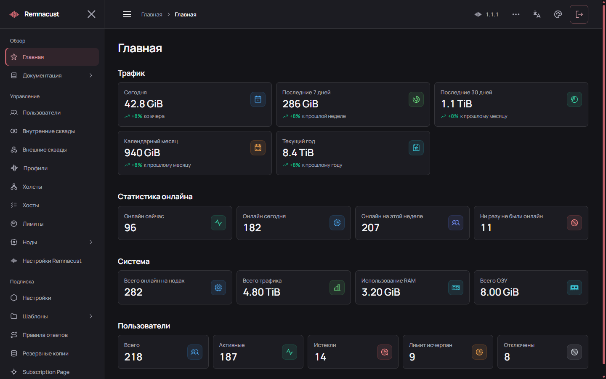

# Remnacust Panel — установка и разработка

**Панель 1.1.7.87**, основа Remnawave backend/frontend 3.4.7. Полный согласованный комплект — [установщик 1.2.124](https://github.com/lottman/Remnacust-installer/releases/tag/v1.2.124), Node 1.1.20 и Core/WASM 1.1.12 на Xray v26.10.31.



## Установка через скрипт

Поддерживаются Ubuntu 22.04/24.04/26.04 LTS и Linux amd64/arm64. На сервере используются готовые образы, PostgreSQL, Valkey и выбранный reverse proxy.

```bash
curl -fsSL --proto '=https' --proto-redir '=https' https://github.com/lottman/Remnacust-installer/releases/latest/download/installer.sh -o installer.sh
sudo bash installer.sh install-panel --version 1.2.124
```

Установщик спрашивает домен, HTTPS и необходимость сайта подписки. После запуска создайте администратора. Управление: `sudo remnacust manage-panel`; обновление: `sudo remnacust upgrade-panel`.

Файлы скриптовой установки: `/opt/remnacust/panel/.env` и `/opt/remnacust/panel/docker-compose.yml`. Активные пути перечислены в `/opt/remnacust/FILES.txt`. Исходный `APP_SECRET` и реквизиты БД сохраняются при обновлении. После изменения `.env` нужен `docker compose up -d --no-build --pull never`, а не только `restart`.

## Возможности и ограничения

Пользователи и FROZEN, HWID и персональные ключи, квоты и скорость пользователя/устройства, профили и хосты, автовыбор, геофайлы, сессии, копии БД и ограниченные API-токены описаны в [основном README](../README.md).

Совместимые изменения конфигурации применяются нодой без обязательного перезапуска Xray. Сообщение о постановке задачи в очередь не подтверждает её применение: итог смотрите в состоянии ноды. Смена порта/транспорта работающего listener требует отдельного listener или явного обслуживания. Полная независимость всех глобальных настроек отдельных профилей не заявляется.

GUI и JSON шаблонов используют один черновик и историю. Предупреждение или сохранённый ошибочный черновик не доказывают, что конфигурация пригодна для запуска. Рабочие профили Xray проходят отдельную серверную проверку.

## Установка из исходников

Следующие команды выполняются из корня **Remnacust-panel**, в отдельном окружении разработки. Для production проще использовать установщик.

```bash
cp panel/backend/.env.sample panel/backend/.env
chmod 600 panel/backend/.env
```

Заполните значения до запуска:

| Переменная | Назначение |
| --- | --- |
| `APP_SECRET` | Случайный постоянный секрет панели; нужен для расшифровки сохранённых данных. |
| `POSTGRES_PASSWORD`, `DATABASE_URL` | Согласованные реквизиты PostgreSQL; пароль в URL должен быть закодирован. |
| `PANEL_DOMAIN`, `FRONT_END_DOMAIN` | Домен панели и разрешённый origin интерфейса. |
| `SUB_PUBLIC_DOMAIN` | Публичный адрес подписок, отдельный от приватного адреса backend. |
| `METRICS_USER`, `METRICS_PASS` | Доступ к метрикам. |
| `WEBHOOK_SECRET_HEADER` | Секрет проверки webhook, если используются. |

`HWID_ENABLED_DEFAULT` относится к первоначальной настройке; обновление сохраняет выбор в БД. Персональные данные устройств требуют включённого `XERA_PERSONAL_SUBSCRIPTIONS` и совместимой ноды/Core.

При source-сборке передавайте метаданные явно: локальная метка Docker не задаёт версию интерфейса.

```bash
REVISION=$(git rev-parse HEAD)
docker build -f panel/Dockerfile \
  --build-arg __RW_METADATA_VERSION=1.1.7.87 \
  --build-arg __RW_METADATA_GIT_BACKEND_COMMIT="$REVISION" \
  --build-arg __RW_METADATA_GIT_FRONTEND_COMMIT="$REVISION" \
  --build-arg __RW_METADATA_GIT_BRANCH=local \
  --label org.opencontainers.image.version=1.1.7.87 \
  --label org.opencontainers.image.revision="$REVISION" \
  -t remnacust-panel:local .
```

Для запуска подготовьте собственный Compose с этим образом, PostgreSQL и Valkey либо используйте source-Compose `panel/backend/docker-compose-prod.yml` с его секцией `build`. Сохраните постоянные тома. HTTPS proxy направляется на loopback-порт backend; БД, кеш и метрики не должны становиться публичными сервисами. Установщик дополнительно создаёт службу управления, реестр установок и синхронизацию `.env`; одна source-сборка их не устанавливает.

## Первое подключение

1. Создайте профиль Xray с inbound и уникальным tag.
2. Добавьте ноду и установите агент с выданным ключом.
3. Назначьте профиль ноде и включите inbound.
4. Разрешите inbound во внутреннем скваде.
5. Создайте хост с внешним адресом и клиентским портом.
6. Добавьте активного пользователя в сквад и импортируйте его подписку.

API-порт ноды и порты inbound выполняют разные задачи. Для автовыбора назначьте конкретный балансер хосту-получателю, а серверы для выбора задайте в составе пула.

## Обновление и копии БД

API, фоновые обработчики и scheduler обновляются согласованно. Перед миграциями сохраняйте БД, `.env`, TLS и конфигурацию proxy. Скриптовая установка: `sudo remnacust upgrade-panel`; отдельная страница: `sudo remnacust upgrade-subscription-page --page-id ID`.

Встроенная ZIP-копия содержит зашифрованный PostgreSQL dump, а не файлы всего сервера. Его бинарный формат восстанавливают средствами PostgreSQL; это не plaintext SQL. [Копии](../docs/BACKUPS.md) · [Совместимость баз](../docs/DATABASE-COMPATIBILITY.md).

## Разработка и документация

- [Backend](backend/README.md): Node.js 24, Prisma, серверные проверки и OpenAPI.
- [Frontend](frontend/README.md): интерфейс, локализация, документация и WASM.
- [Сборка и проверки](../docs/BUILDING.md).
- [Геофайлы](../docs/GEOFILES.md), [автовыбор](../docs/XRAY-AUTOSELECT.md), [лимиты](../docs/HOST-LIMITS.md).
- [API](../docs/API.md), [OpenAPI](backend/openapi.json), [руководство RU](frontend/public/documentation/guide-ru.md), [EN](frontend/public/documentation/guide-en.md), [FA](frontend/public/documentation/guide-fa.md), [ZH](frontend/public/documentation/guide-zh.md).

Backend и frontend сохраняют собственные файлы `LICENCE`; авторство перечислено в [NOTICE.md](../NOTICE.md).
